# UD1 · Interfaces gráficas con editor visual

## Desarrollo de Interfaces

### JavaFX · Scene Builder · FXML · CSS · Eventos

2.º DAM

> De una interfaz diseñada visualmente a una aplicación funcional.


---
# Índice de la unidad

<div class="index" markdown="1">
<div markdown="1">

### [1. Introducción](#1-introduccion-a-las-interfaces-graficas)
- [1.1 Objetivos](#11-objetivos-de-la-unidad) · [1.2 GUI](#12-que-es-una-gui) · [1.3 Consola/GUI](#13-de-la-consola-a-una-interfaz-grafica)
- [1.4 Calidad](#14-que-hace-que-una-interfaz-sea-buena) · [1.5 Evolución](#15-evolucion-de-las-gui-en-java) · [1.6–1.8 AWT/Swing/SWT](#16-awt)
- [1.9 JavaFX](#19-javafx-nuestra-tecnologia) · [1.10 Responsabilidades](#110-javafx-no-es-solo-arrastrar-botones)

### [2. Conceptos fundamentales](#2-conceptos-fundamentales_1)
- [2.1 Modelo mental](#21-modelo-mental-stage-scene-y-node) · [2.2 Stage, Scene y Node](#22-stage-scene-y-node)
- [2.3 Stage](#23-stage) · [2.4 Scene](#24-scene) · [2.5 Node](#25-node) · [2.6 Árbol](#26-la-interfaz-como-un-arbol)

### [3. Entorno de desarrollo](#3-preparacion-del-entorno-de-desarrollo)
- [3.1 Preparación](#31-preparacion-del-entorno) · [3.2 JDK](#32-jdk) · [3.3 Comprobación](#33-comprobar-java)
- [3.4–3.7 IDE](#34-que-es-un-ide) · [3.8–3.9 JavaFX SDK](#38-javafx-sdk)
- [3.10–3.15 Maven y estructura del proyecto](#310-maven)

### [4. Componentes JavaFX](#4-componentes-javafx_1)
- [4.1 Controles](#41-controles-javafx-y-otros-elementos) · [4.2–4.8 Controles básicos](#42-label)
- [4.9–4.20 Controles adicionales](#49-passwordfield)

### [5. Layouts](#5-layouts-organizar-la-interfaz)
- [5.1 Distribución](#51-layouts-dominar-la-distribucion) · [5.2–5.13 Layouts y composición](#52-vbox)

### [6. Propiedades](#6-propiedades-e-inspector)
- [6.1 Inspector](#61-propiedades-comprender-el-inspector) · [6.2–6.5 Identificadores y estados](#62-id-frente-a-fxid)

### [7. Scene Builder](#7-scene-builder_1)
- [7.1–7.9 Diseño visual y formulario](#71-que-es-scene-builder)

### [8. Primera aplicación](#8-actividad-1-primera-aplicacion-javafx)
- [8.1 Identificadores del formulario](#81-configura-los-identificadores)

### [9. Actividad MVC](#9-actividad-2-guiada-saludador-con-modelo-vista-y-controller)
- Saludador con Modelo, Vista y Controller

</div>
<div markdown="1">

### [10. FXML](#10-fxml-describir-la-interfaz)
- [10.1–10.5 Estructura y responsabilidades](#101-fxml-y-separacion-de-responsabilidades)
- [10.6–10.10 Imports, FXMLLoader y @FXML](#106-imports)

### [11. Controller](#11-controller-conectar-la-interfaz-con-java)
- [11.1–11.5 Lógica e inicialización](#111-controller-la-logica-de-la-vista)
- [11.6–11.10 Conexión y errores FXML](#116-fxml-controller-conexion-completa)

### [12. Eventos](#12-eventos-e-interaccion)
- [12.1–12.9 Interacción, selección y listeners](#121-eventos-e-interaccion)

### [13. Validación](#13-validacion_1)
- [13.1–13.6 Texto, números, email y estados](#131-validacion-hacer-interfaces-robustas)

### [14. Alert y diálogos](#14-alert-y-dialogos_1)
- [14.1–14.6 Información, errores y confirmación](#141-alert-y-dialogos)

### [15. CSS](#15-css-en-javafx)
- [15.1–15.7 Clases, selectores y pseudoclases](#151-css-en-javafx)

### [16. Navegación](#16-navegacion-entre-pantallas)
- [16.1–16.6 Cambio de vistas y menú](#161-navegacion-entre-pantallas)

</div>
<div markdown="1">

### [17. Accesibilidad](#17-accesibilidad-y-usabilidad)
- [17.1–17.4 Usabilidad y teclado](#171-accesibilidad-y-usabilidad)

### [18. Arquitectura básica](#18-arquitectura-basica_1)
- [18.1–18.3 Organización y responsabilidades](#181-arquitectura-basica-de-una-aplicacion-javafx)

### [19. Proyecto de la unidad](#19-proyecto-de-la-unidad_1)
- [19.1–19.3 Gestor de alumnos y evaluación](#191-proyecto-de-la-unidad)

### [20. Proyecto integrador](#20-proyecto-integrador-gestor-de-alumnos)
- [20.1–20.12 Modelo, tabla e integración](#201-proyecto-integrador-gestor-de-alumnos)

### [21. Errores típicos](#21-errores-tipicos-y-diagnostico)
- [21.1–21.6 Diagnóstico y soluciones](#211-errores-tipicos-y-como-diagnosticarlos)

### [22. Actividades y evaluación](#22-actividades-y-evaluacion_1)
- [22.1–22.8 Práctica guiada y pruebas](#221-actividades-y-evaluacion)
- [22.9–22.15 Repaso y reto final](#229-preguntas-de-repaso)
- [22.16–22.20 Calculadora y gestión de personas](#2216-practica-final)

### [23. Resumen](#23-resumen-de-la-unidad)
- [23.1–23.5 Flujo, repaso y siguientes pasos](#231-resumen-de-la-unidad)

### [24. Cierre](#24-cierre-y-preparacion-de-la-siguiente-unidad)
- [24.1–24.5 Resultados, evidencias y preparación](#241-resultado-esperado-de-la-ud1)

</div>
</div>

---

# Cómo vamos a aprender la UD1

<div class="box" markdown="1">


→ Primero entendemos las piezas 
→ después las organizamos 
→ después las diseñamos visualmente 
→ después las conectamos con Java 
→ finalmente construimos una aplicación completa.

</div>

---

```text
JavaFX
  ↓
Componentes + Layouts + Propiedades
  ↓
Scene Builder
  ↓
FXML
  ↓
Controller + Eventos
  ↓
Validación + Diálogos + CSS
  ↓
Navegación + Arquitectura
  ↓
Proyecto integrador
```

> **La herramienta aparece después de comprender qué estamos diseñando.**

---

# 1. Introducción a las interfaces gráficas

---

# 1.1 Objetivos de la unidad

## ¿Qué vamos a aprender?

Al terminar esta unidad seremos capaces de:

- Crear interfaces gráficas con JavaFX.
- Diseñarlas mediante Scene Builder.
- Comprender y modificar FXML.
- Programar eventos con Java.
- Organizar interfaces mediante layouts.
- Aplicar estilos con CSS.
- Crear una aplicación con varias pantallas.

---

# 1.2 ¿Qué es una GUI?

Una **GUI (Graphical User Interface)** es la parte visual de una aplicación con la que interactúa la persona usuaria.

En lugar de escribir órdenes en una consola, utilizamos elementos visuales:

- Ventanas
- Botones
- Campos de texto
- Menús y listas
- Imágenes y cuadros de diálogo

---

# 1.3 De la consola a una interfaz gráfica

### Consola

```text
Introduce tu nombre:
> Ana

Hola Ana
```

### GUI

```text
┌───────────────────────────┐
│      MI APLICACIÓN        │
├───────────────────────────┤
│ Nombre: [____________]    │
│                           │
│       [ ACEPTAR ]         │
└───────────────────────────┘
```

La información puede ser la misma. **La forma de interactuar cambia.**

---
# 1.4 ¿Qué hace que una interfaz sea buena?
Una buena interfaz no consiste en colocar muchos controles.

Debe ser:

- **Clara:** el usuario entiende qué puede hacer.

- **Consistente:** elementos similares se comportan igual.

- **Predecible:** las acciones producen resultados esperados.

- **Accesible:** puede utilizarla el mayor número de personas posible.

- **Adaptable:** funciona correctamente en diferentes tamaños.

- **Mantenible:** el código puede evolucionar sin convertirse en un problema.

\>**Diseñar una interfaz también es diseñar la experiencia de uso.**

---


# 1.5 Evolución de las GUI en Java

Java ha utilizado diferentes tecnologías para construir interfaces de escritorio.

```text

AWT  →  Swing  →  SWT  →  JavaFX

1996    1998     2001      actualidad

```

No necesitamos memorizar fechas. Lo importante es entender **\*\*por qué aparecen nuevas herramientas\*\***: mejores componentes, estilos, separación de responsabilidades y una experiencia de desarrollo más cómoda.

---


# 1.6 AWT
**\*\*AWT — Abstract Window Toolkit\*\*** fue la primera biblioteca gráfica de Java. 

<table>

<tr>

<td>

```java 

Frame ventana = new Frame("Ejemplo"); 

Button boton = new Button("Aceptar"); 

``` 

Características: 

- Componentes ligados en gran medida al sistema operativo. 

- API sencilla. 

- Limitada frente a soluciones posteriores. 

**\*\*Hoy:\*\*** principalmente interés histórico y mantenimiento de código antiguo.

</td>

<td>

  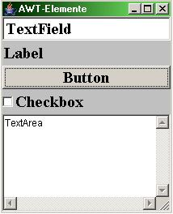

</td>

</tr>

</table>

---


# 1.7 Swing

<table>

<tr>

<td>

Swing amplió enormemente los componentes disponibles en Java.

```java

JFrame ventana = new JFrame();

JButton boton = new JButton("Aceptar");

```

Ejemplos:

- \`JFrame\`

- \`JPanel\`

- \`JTable\`

- \`JComboBox\`


</td>

<td>

  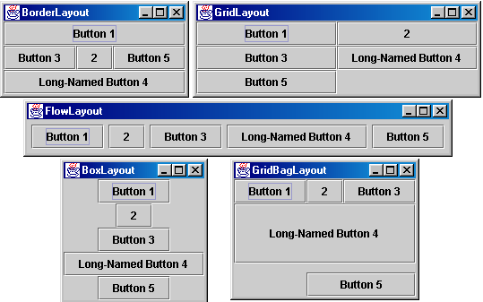

</td>

</tr>

</table>

Sigue existiendo y podemos encontrarla en aplicaciones antiguas, pero para esta unidad trabajaremos con \*\*JavaFX\*\*.

---


# 1.8 SWT

<table>

<tr>

<td>

\*\*SWT — Standard Widget Toolkit\*\* fue impulsado por Eclipse para trabajar con widgets nativos.

```java

Button btn = new Button(shell, SWT.PUSH);

```

</td>

<td>

  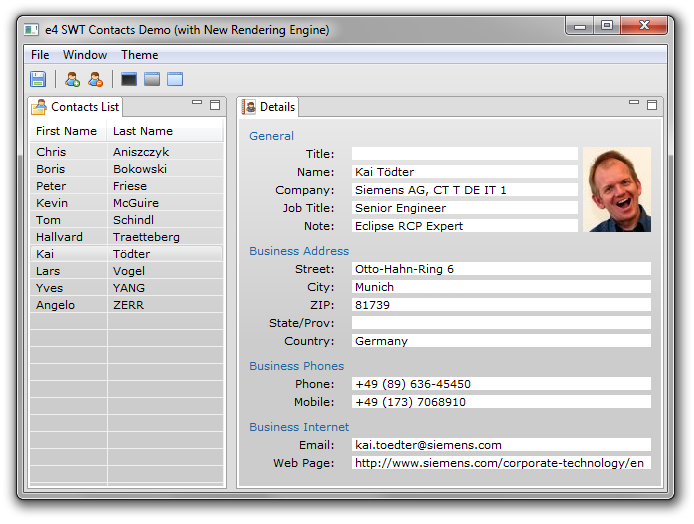

</td>

</tr>

</table>

Tiene especial relación con el ecosistema Eclipse.

Para nuestro módulo no será la tecnología principal.

---


# 1.9 JavaFX: nuestra tecnología

## ¿Por qué JavaFX?

<table>

<tr>

<td>

JavaFX proporciona una base moderna para estudiar el desarrollo de interfaces en Java:

- Componentes gráficos.

- Layouts.

- Eventos.

- FXML.

- CSS.

- Animaciones.

- Gráficos y multimedia.

Además, **\*\*Scene Builder\*\*** permite diseñar la interfaz visualmente y generar FXML.

</td>

<td>

  

</td>

</tr>

</table>

---


# 1.10 JavaFX no es solo "arrastrar botones"

Durante la unidad aprenderemos a separar tres responsabilidades:

<div class="two" markdown="1">

<div class="box" markdown="1">

### FXML

**Qué hay** en la interfaz.

</div>

<div class="box" markdown="1">

### Java

**Qué hace** la aplicación.

</div>

</div>

Y una tercera:

<div class="box" markdown="1">

### CSS

**Cómo se ve** la interfaz.

</div>

---
# 2. Conceptos fundamentales
---


# 2.1 Modelo mental: Stage, Scene y Node

## De la ventana a los componentes

Antes de usar Scene Builder debemos comprender qué estamos diseñando.

```text

VENTANA

   ↓

 ESCENA

   ↓

CONTENEDOR

   ↓

 COMPONENTES

```

En JavaFX estos conceptos aparecen como:

**\*\*Stage → Scene → Node\*\***

---


# 2.2 Stage, Scene y Node

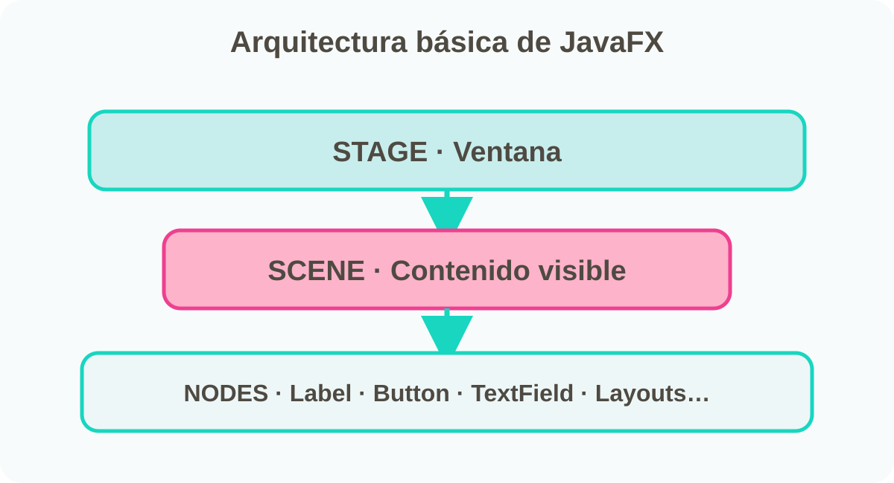

---


# 2.3 Stage

El \`Stage\` representa una **\*\*ventana\*\*** de la aplicación.

Puede tener:

- Título.

- Tamaño.

- Posición.

- Estado maximizado/minimizado.

- Visibilidad.

- Una \`Scene\` asociada.

```java

stage.setTitle("Gestión de alumnos");

stage.show();

```

---


# 2.4 Scene

La \`Scene\` contiene lo que aparece dentro de la ventana.

```java

Scene scene = new Scene(root, 800, 600);

stage.setScene(scene);

```

Podemos cambiar la escena para mostrar otra pantalla de la aplicación.

\> **\*\*Stage = ventana · Scene = contenido de esa ventana\*\***

---


# 2.5 Node

Un \`Node\` es un elemento de la escena.

Ejemplos:

- \`Label\`

- \`Button\`

- \`TextField\`

- \`ImageView\`

- \`VBox\`

- \`GridPane\`

Los contenedores también forman parte del árbol de nodos.

---


# 2.6 La interfaz como un árbol

```text

Stage

└── Scene

    └── VBox

        ├── Label

        ├── TextField

        └── Button

```

Esto será fundamental cuando utilicemos **\*\*Scene Builder\*\***.

La ventana no es una colección desordenada de controles: existe una **\*\*jerarquía\*\***.

---
# 3. Preparación del entorno de desarrollo
---


# 3.1 Preparación del entorno

## Herramientas necesarias

Para trabajar necesitamos:

1\. **\*\*JDK\*\*** — desarrollar y ejecutar Java.

2\. **\*\*IDE\*\*** — escribir, ejecutar y depurar.

3\. **\*\*JavaFX\*\*** — crear la interfaz.

4\. **\*\*Maven\*\*** — gestionar dependencias.

5\. **\*\*Scene Builder\*\*** — diseñar visualmente.

---


# 3.2 JDK

El **\*\*JDK — Java Development Kit\*\*** contiene las herramientas necesarias para desarrollar Java.

Incluye, entre otras:

- Compilador \`javac\`.

- JVM.

- Bibliotecas estándar.

- Herramientas de desarrollo.

### En el aula

Trabajaremos con la versión **\*\*JDK 26\*\***, usaremos una línea compatible de JavaFX 26.


---


# 3.3 Comprobar Java


En una terminal:

```bash

java --version

```

Y para comprobar el compilador:

```bash

javac --version

```

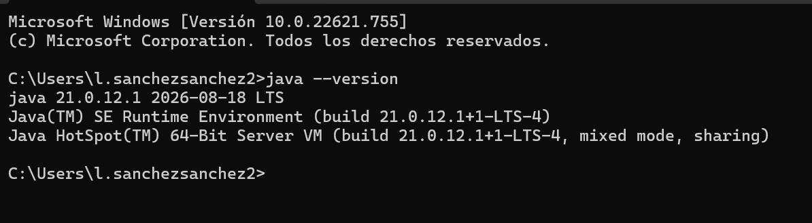

---
 

### Actividad rápida

Anota:

- versión de Java

- versión del compilador

- sistema operativo

---


# 3.4 ¿Qué es un IDE?

Un **\*\*IDE — Integrated Development Environment\*\*** reúne en una misma herramienta:

- Editor de código.

- Compilación.

- Ejecución.

- Depuración.

- Gestión del proyecto.

- Autocompletado.

Ejemplos:

**\*\*IntelliJ IDEA · NetBeans · Eclipse · VS Code\*\***

---


# 3.5 IntelliJ IDEA

<table>

<tr>

<td>

Para nuestras prácticas utilizaremos \*\*IntelliJ IDEA\*\*, salvo indicación del centro.

Nos interesa especialmente porque permite trabajar cómodamente con:

- Java.

- Maven.

- FXML.

- Scene Builder.

- Depuración.

</td>

<td>

  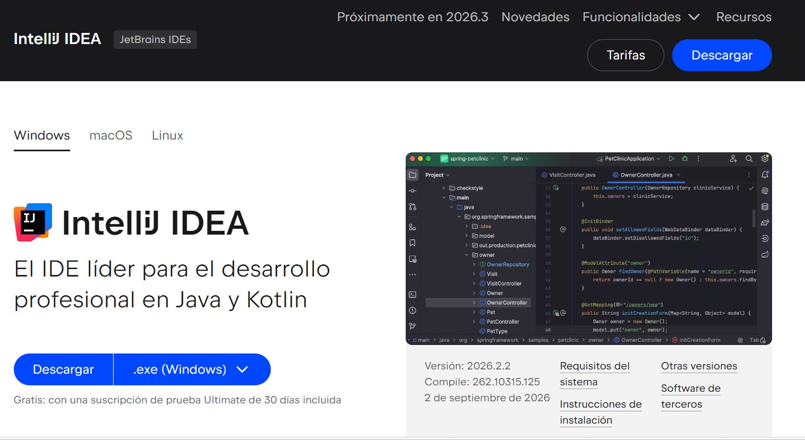

</td>

</tr>

</table>

\> El IDE es una herramienta. Lo importante es comprender qué estamos construyendo.

---


# 3.6 Otros IDE para Java

Además de IntelliJ IDEA, existen otras herramientas habituales:

- **\*\*NetBeans:\*\*** sencillo y utilizado históricamente en FP.

- **\*\*Eclipse:\*\*** potente y muy configurable.

- **\*\*Visual Studio Code:\*\*** ligero y ampliable mediante extensiones.

La herramienta puede cambiar, pero los conceptos de JavaFX, FXML y eventos son los mismos.

---


# 3.7 ¿Qué IDE utilizaremos?

Para las prácticas utilizaremos **\*\*IntelliJ IDEA Community\*\***, salvo indicación del centro.

Es gratuito y ofrece una buena integración con Java, Maven, FXML y Scene Builder.

---


# 3.8 JavaFX SDK

Desde Java 11, JavaFX ya no forma parte del JDK.

Según la configuración del proyecto, podemos trabajar con las dependencias de Maven o instalar el **\*\*JavaFX SDK\*\***.

El SDK incluye las bibliotecas necesarias para crear ventanas, controles, layouts, multimedia y animaciones.

---


# 3.9 Estructura del JavaFX SDK

```text

javafx-sdk

├── bin

├── legal

└── lib

```

La carpeta \`lib\` contiene los módulos \`.jar\` que utiliza la aplicación.

---


# 3.10 Maven

Maven nos ayuda a gestionar el proyecto y sus dependencias.

En lugar de descargar y configurar manualmente cada biblioteca, declaramos lo que necesita el proyecto.

```text

pom.xml

   ↓

dependencias

   ↓

Maven las resuelve

   ↓

Proyecto JavaFX

```

---


# 3.11 ¿Qué es una dependencia?

Una dependencia es una biblioteca que nuestro proyecto necesita para funcionar.

Ejemplo:

```xml

<dependency>

    <groupId>org.openjfx</groupId>

    <artifactId>javafx-controls</artifactId>

    <version>21</version>

</dependency>

```

No necesitamos memorizar todavía el \`pom.xml\`. Aprenderemos a interpretarlo y utilizarlo.

---


# 🔗 Herramienta → Librería → Editor

Para crear una interfaz gráfica en JavaFX intervienen **varios elementos**, pero cada uno tiene una función diferente.

| Elemento | ¿Qué función cumple? |
|---|---|
| **JavaFX** | Librería/framework para construir la interfaz gráfica |
| **Scene Builder** | Editor visual para diseñar la interfaz |
| **FXML** | Lenguaje declarativo que describe la interfaz |
| **IntelliJ IDEA** | IDE para programar y ejecutar la aplicación |
| **Maven** | Gestión del proyecto y sus dependencias |
| **CSS** | Define el aspecto y los estilos visuales |
| **Java** | Contiene la lógica y el comportamiento de la aplicación |


---

### 🧩 ¿Cómo se relacionan?

**JavaFX** proporciona los componentes  
↓  
**Scene Builder** permite colocarlos visualmente  
↓  
**FXML** guarda la descripción de la interfaz  
↓  
**IntelliJ IDEA** permite programar la lógica en **Java**  
↓  
**Java + JavaFX + FXML + CSS** → **Aplicación gráfica**

> 💡 **Idea clave:** Scene Builder sirve para **diseñar**, FXML para **describir la interfaz**, JavaFX proporciona los **componentes** y Java controla el **comportamiento**.
Java	Lógica y comportamiento

---

# 3.12 Estructura del proyecto

Una estructura habitual será:

```text

src

└── main

    ├── java

    │   ├── App.java

    │   └── Controller.java

    └── resources

        ├── principal.fxml

        └── estilos.css

```

### Idea clave

**Java → comportamiento**
**FXML → estructura visual**
**CSS → apariencia**

---


# 3.13 Archivos Java

Contienen la lógica de la aplicación, la configuración de eventos y el comportamiento de los controladores.

```java

public class App {

}

```

---


# 3.14 Archivos FXML

Describen la estructura visual de la interfaz y la jerarquía de sus componentes.

```xml

<VBox>

  <Button text="Aceptar"/>

</VBox>

```

---


# 3.15 Archivos CSS

Definen la apariencia de los controles sin mezclar los estilos con la lógica Java.

```css

.button {

  -fx-background-color: #1976D2;

  -fx-text-fill: white;

}

```

---
# 3.16 Antes de diseñar: conozcamos las piezas
---


# 4. Componentes JavaFX
---


# 4.1 Controles JavaFX y otros elementos

##  Controles de entrada y selección

Además de los controles básicos trabajaremos con:

- `TextField`
- `PasswordField`
- `TextArea`
- `CheckBox`
- `RadioButton`
- `ToggleGroup`
- `ComboBox`
- `ChoiceBox`
- `DatePicker`
- `Spinner`
- `Slider`

---


# 4.2 Label

Un `Label` sirve para mostrar información que la persona usuaria debe leer, como el nombre de un campo, un aviso o el resultado de una operación.

```java
Label lblNombre = new Label("Nombre");
```

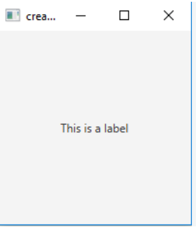

---

# 4.3 Button

Un `Button` representa una acción. Su texto debe indicar con claridad qué ocurrirá al pulsarlo, por ejemplo “Guardar”, “Cancelar” o “Calcular”.

```java
Button btnAceptar = new Button("Aceptar");
```

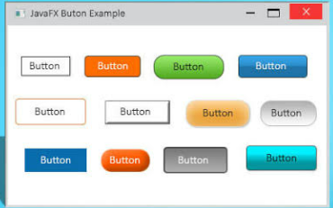

---

# 4.4 TextField

Un `TextField` permite introducir una sola línea de texto. Es apropiado para nombres, correos electrónicos, teléfonos o cualquier dato breve.

```java
TextField txtNombre = new TextField();
```

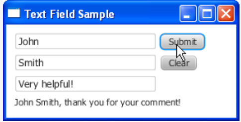

---

# 4.5 TextArea

Un `TextArea` se utiliza cuando el texto puede ocupar varias líneas, como observaciones, comentarios o una descripción extensa.

```java
TextArea txtObservaciones = new TextArea();
```

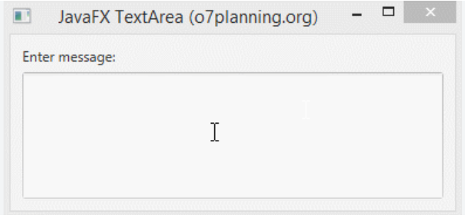

---

# 4.6 CheckBox

Un `CheckBox` representa una opción independiente que puede estar activada o desactivada. Es útil para aceptar condiciones o seleccionar preferencias.

```java
CheckBox chk = new CheckBox("Acepto condiciones");
```

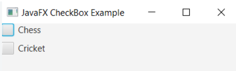

---

# 4.7 RadioButton

Los `RadioButton` se utilizan cuando hay que escoger una opción entre varias. Normalmente se agrupan para que solo una pueda estar seleccionada.

```java
RadioButton rb1 = new RadioButton("Opción 1");
```

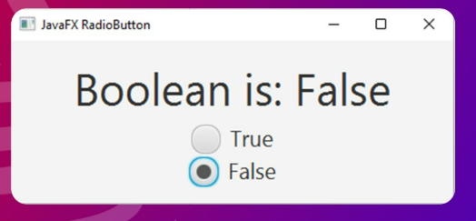

---

# 4.8 ComboBox

Un `ComboBox` muestra una lista desplegable y permite elegir un valor sin ocupar espacio con todas las opciones visibles.

```java
ComboBox<String> combo = new ComboBox<>();
combo.getItems().addAll("DAM","DAW");
```

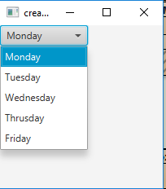

---

# 4.9 PasswordField

Permite introducir contraseñas ocultando visualmente los caracteres.

```java
PasswordField txtPassword = new PasswordField();

String password = txtPassword.getText();
```

En Scene Builder:

```text
Library
 └── Controls
      └── PasswordField
```

**Uso habitual:** formularios de acceso.

---


# 4.10 ToggleGroup + RadioButton

Para que varios `RadioButton` formen un grupo de selección única:

```java
RadioButton rbAlumno = new RadioButton("Alumno");
RadioButton rbProfesor = new RadioButton("Profesor");

ToggleGroup grupo = new ToggleGroup();

rbAlumno.setToggleGroup(grupo);
rbProfesor.setToggleGroup(grupo);
```

Para obtener la opción:

```java
RadioButton seleccionado =
    (RadioButton) grupo.getSelectedToggle();
```

> Un `RadioButton` aislado no expresa necesariamente una elección exclusiva.

---


# 4.11 ChoiceBox

Es otra opción para seleccionar un valor.

```java
ChoiceBox<String> choice = new ChoiceBox<>();

choice.getItems().addAll(
    "DAM",
    "DAW",
    "ASIR"
);
```

Diferencia conceptual:

```text
ComboBox  → selección desplegable con más posibilidades de interacción
ChoiceBox → selección sencilla de una opción
```

---


# 4.12 DatePicker

Permite seleccionar una fecha.

```java
DatePicker fecha = new DatePicker();

LocalDate nacimiento = fecha.getValue();
```

Importación:

```java
import java.time.LocalDate;
```

Comprobación:

```java
if (fecha.getValue() == null) {
    // No se ha seleccionado fecha
}
```

---


# 4.13 Spinner

Permite seleccionar valores dentro de un rango.

```java
Spinner<Integer> edad =
    new Spinner<>(0, 120, 18);
```

Obtener el valor:

```java
int valor = edad.getValue();
```

Puede utilizarse para:

- edad;
- cantidad;
- unidades;
- horas;
- niveles.

---


# 4.14 Slider

Permite seleccionar un valor mediante un control deslizante.

```java
Slider volumen = new Slider(0, 100, 50);
```

Obtener el valor:

```java
double valor = volumen.getValue();
```

---


# 4.15 ListView

Muestra una lista de elementos.

```java
ListView<String> lista = new ListView<>();

lista.getItems().addAll(
    "Java",
    "JavaFX",
    "FXML",
    "CSS"
);
```

Obtener la selección:

```java
String elemento =
    lista.getSelectionModel()
         .getSelectedItem();
```

---


# 4.16 TableView

`TableView` permite representar información tabular.

```text
┌────────────┬───────────────┬─────────┐
│ Nombre     │ Apellidos     │ Curso   │
├────────────┼───────────────┼─────────┤
│ Ana        │ García        │ DAM     │
│ Luis       │ Pérez         │ DAW     │
└────────────┴───────────────┴─────────┘
```

Es especialmente importante para aplicaciones de gestión.

```java
TableView<Persona> tabla = new TableView<>();
```

Una tabla normalmente utiliza:

```text
TableView
 ├── TableColumn
 ├── TableColumn
 └── TableColumn
```

---


# 4.17 ImageView

Permite mostrar imágenes.

```java
Image imagen =
    new Image(getClass()
        .getResourceAsStream("/img/logo.png"));

ImageView vista = new ImageView(imagen);
```

Podemos controlar:

```java
vista.setFitWidth(200);
vista.setPreserveRatio(true);
```

> Las imágenes utilizadas por la aplicación deben estar correctamente ubicadas en `resources`.

---


# 4.18 Menús

JavaFX permite construir menús mediante:

```text
MenuBar
 ├── Menu "Archivo"
 │    ├── MenuItem "Nuevo"
 │    ├── MenuItem "Guardar"
 │    └── MenuItem "Salir"
 └── Menu "Ayuda"
      └── MenuItem "Acerca de"
```

Ejemplo:

```java
Menu archivo = new Menu("Archivo");

MenuItem salir = new MenuItem("Salir");

archivo.getItems().add(salir);
```

---


# 4.19 TabPane

Permite organizar contenido en pestañas.

```text
┌─────────┬─────────┬────────────┐
│ Alumnos │ Cursos  │ Configuración │
├─────────┴─────────┴────────────┤
│                                │
│       contenido de pestaña     │
│                                │
└────────────────────────────────┘
```

Es útil cuando existen diferentes áreas relacionadas dentro de una misma pantalla.

---


# 4.20 ProgressBar y ProgressIndicator

Permiten mostrar el progreso de una operación.

```java
ProgressBar barra = new ProgressBar(0.5);
```

El valor está comprendido entre:

```text
0.0  ───────────────  1.0
0%                    100%
```

---
# 5. Layouts: organizar la interfaz
---


# 5.1 Layouts · dominar la distribución

Cada layout resuelve una necesidad diferente.

- `VBox` → elementos en vertical.
- `HBox` → elementos en horizontal.
- `GridPane` → filas y columnas.
- `BorderPane` → zonas principales.
- `StackPane` → elementos superpuestos.
- `AnchorPane` → anclaje a bordes.
- `FlowPane` → distribución automática en flujo.
- `TilePane` → elementos en celdas de tamaño uniforme.

> **No elegimos un layout porque "queda bien"; lo elegimos por la relación que existe entre los elementos.**

---


# 5.2 VBox

`VBox` coloca los elementos uno debajo de otro. Es una buena opción para formularios sencillos o para apilar un título, varios campos y una fila de botones.

```java
VBox root = new VBox();
```

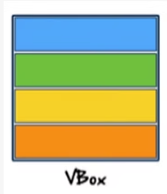

**Elementos en vertical.**

---

# 5.3 HBox

`HBox` coloca los elementos en una misma fila. Se utiliza habitualmente para agrupar botones, etiquetas con sus campos o elementos de una barra de herramientas.

```java
HBox root = new HBox();
```

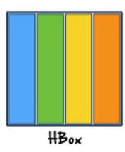

**Elementos en horizontal.**

---

# 5.4 GridPane

`GridPane` organiza los controles mediante filas y columnas. Resulta especialmente útil en formularios, porque permite alinear las etiquetas y los campos de entrada.

```java
GridPane grid = new GridPane();
```

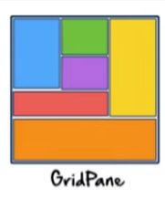

**Organiza en filas y columnas.**

---

# 5.5 BorderPane

`BorderPane` divide la ventana en cinco zonas: `top`, `bottom`, `left`, `right` y `center`.

```java
BorderPane root = new BorderPane();
root.setTop(new Label("Cabecera"));
root.setLeft(new Button("Menú"));
root.setCenter(new TextArea());
root.setBottom(new Label("Pie de ventana"));
```

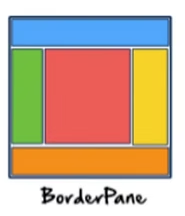

La zona `center` ocupa todo el espacio que queda libre después de colocar las otras zonas.

---

# 5.6 Otros layouts

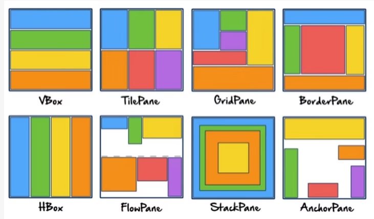

Los layouts se combinan según la estructura que necesitemos. Más adelante trabajaremos también con `StackPane`, `AnchorPane`, `FlowPane` y `TilePane`.

---

# 5.7 StackPane

Permite colocar nodos unos encima de otros.

```java
StackPane root = new StackPane();

Label fondo = new Label("Fondo");
Button boton = new Button("Encima");

root.getChildren().addAll(fondo, boton);
```

Es útil para:

- superponer controles;
- crear pantallas de carga;
- colocar mensajes sobre una vista;
- construir composiciones visuales.

```text
┌─────────────────────────┐
│                         │
│        Fondo            │
│          [Botón]        │
│                         │
└─────────────────────────┘
```

---


# 5.8 AnchorPane

Permite anclar nodos a los bordes del contenedor.

```text
┌─────────────────────────┐
│ [Logo]                  │
│                         │
│          Formulario     │
│                         │
│                  [OK]   │
└─────────────────────────┘
```

En Scene Builder podemos configurar:

- Anchor Top
- Anchor Bottom
- Anchor Left
- Anchor Right

Ejemplo conceptual:

```text
Button
 ├── Anchor Top: 20
 └── Anchor Right: 20
```

> **Precaución:** un `AnchorPane` no sustituye a un diseño adaptable. Para formularios, suele ser preferible combinar `VBox`, `HBox`, `GridPane` y `BorderPane`.

---


# 5.9 FlowPane

Coloca los nodos uno detrás de otro y puede cambiar de línea cuando no hay espacio.

```text
[Uno] [Dos] [Tres] [Cuatro]
[Cinco] [Seis] [Siete]
```

Es útil para:

- etiquetas;
- botones;
- categorías;
- elementos que deben reorganizarse automáticamente.

---


# 5.10 TilePane

Distribuye los elementos en celdas de tamaño uniforme.

```text
┌──────┬──────┬──────┐
│  1   │  2   │  3   │
├──────┼──────┼──────┤
│  4   │  5   │  6   │
└──────┴──────┴──────┘
```

Puede ser útil para:

- paneles de opciones;
- teclados;
- menús visuales;
- galerías sencillas.

---


# 5.11 Combinar layouts

Las interfaces reales utilizan layouts dentro de otros layouts.

```text
BorderPane
├── TOP
│   └── HBox
├── LEFT
│   └── VBox
├── CENTER
│   └── GridPane
└── BOTTOM
    └── HBox
```

### Ejemplo

```java
BorderPane root = new BorderPane();

HBox menu = new HBox(10);
VBox lateral = new VBox(10);
GridPane formulario = new GridPane();
HBox acciones = new HBox(10);

root.setTop(menu);
root.setLeft(lateral);
root.setCenter(formulario);
root.setBottom(acciones);
```

> **Esta composición es una de las ideas más importantes de Scene Builder.**

---


# 5.12 Propiedades fundamentales de los layouts

Debemos conocer especialmente:

### `padding`

Espacio entre el borde del contenedor y su contenido.

### `spacing`

Espacio entre elementos.

### `alignment`

Alineación del contenido.

### `prefWidth` / `prefHeight`

Tamaño preferido.

### `minWidth` / `maxWidth`

Límites de tamaño.

### Grow / Constraints

Indican cómo puede crecer un nodo cuando aumenta el espacio disponible.

---


# 5.13 Error frecuente · colocar todo con posiciones

```text
❌ Button en X=430, Y=250
❌ Label en X=100, Y=80
❌ TextField en X=220, Y=80
```

Esto puede funcionar en una captura concreta, pero fallar cuando:

- cambia el tamaño de la ventana;
- cambia el texto;
- cambia la fuente;
- cambia la resolución;
- se adapta la aplicación.

```text
✅ VBox
   └── GridPane
       └── HBox de botones
```

---
# 6. Propiedades e Inspector
---


# 6.1 Propiedades · comprender el Inspector

##  No todas las propiedades hacen lo mismo

En Scene Builder podemos encontrar propiedades relacionadas con:

### Identidad

```text
fx:id
id
styleClass
```

### Texto

```text
text
promptText
```

### Estado

```text
disable
visible
managed
```

---


### Tamaño

```text
prefWidth
prefHeight
minWidth
maxWidth
```

### Apariencia

```text
style
styleClass
```

### Layout

```text
padding
spacing
alignment
constraints
```

### Eventos

```text
onAction
onMouseClicked
onKeyPressed
```

---


# 6.2 `id` frente a `fx:id`

Son conceptos diferentes.

```xml
<Button
    id="botonPrincipal"
    fx:id="btnGuardar"
    text="Guardar"/>
```

### `fx:id`

Permite asociar el nodo con un campo del controlador.

```java
@FXML
private Button btnGuardar;
```

### `id`

Es un identificador que puede utilizarse, entre otras cosas, con selectores CSS.

```css
#botonPrincipal {
    -fx-font-weight: bold;
}
```

> **No debemos confundir `id` con `fx:id`.**

---


# 6.3 `styleClass`

Permite aplicar una clase CSS.

FXML:

```xml
<Button
    text="Guardar"
    styleClass="boton-principal"/>
```

CSS:

```css
.boton-principal {
    -fx-font-weight: bold;
}
```

---


# 6.4 `style` inline

También podemos escribir un estilo directamente:

```xml
<Button
    text="Aceptar"
    style="-fx-font-weight: bold;"/>
```

Pero para una aplicación mantenible suele ser preferible:

```text
FXML
 ↓
styleClass
 ↓
CSS externo
```

---


# 6.5 `disable`, `visible` y `managed`

### `disable`

El control está visible pero no se puede utilizar.

```java
btnGuardar.setDisable(true);
```

### `visible`

Controla si se muestra.

```java
lblAviso.setVisible(false);
```

### `managed`

Indica si el layout debe tener en cuenta el nodo.

```java
lblAviso.setManaged(false);
lblAviso.setVisible(false);
```

Esto es útil para ocultar un mensaje sin dejar un hueco innecesario.

---
# 7. Scene Builder


## Del código al diseño visual

Ahora vamos a dejar de construir toda la interfaz mediante código.

Utilizaremos: **Scene Builder** para diseñar visualmente y generar FXML.

---


# 7.1 ¿Qué es Scene Builder?

Scene Builder es un **\*\*editor visual de interfaces JavaFX\*\***.

Permite diseñar mediante **\*\*drag & drop\*\*** y guardar la estructura de la interfaz como **\*\*FXML\*\***.

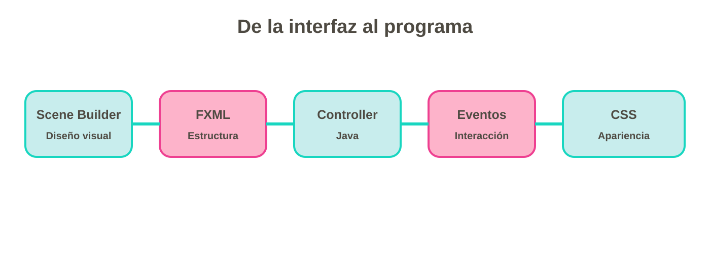

---


# 7.2 ¿Qué problema resuelve?

Sin editor visual podemos escribir:

```java

Label lbl = new Label("Nombre");

TextField txt = new TextField();

Button btn = new Button("Guardar");

```

Con Scene Builder podemos diseñar la estructura visual y dejar que FXML describa esa estructura.

### Pero cuidado

**\*\*Scene Builder no sustituye al programador.\*\***

---


# 7.3 Las zonas principales de Scene Builder

Cuando abramos Scene Builder encontraremos diferentes áreas:

1\. **\*\*Library\*\*** — componentes.

2\. **\*\*Hierarchy\*\*** — árbol de la interfaz.

3\. **\*\*Canvas\*\*** — diseño visual.

4\. **\*\*Inspector\*\*** — propiedades.

5\. **\*\*Properties\*\*** — texto, identificadores, eventos…

6\. **\*\*Layout\*\*** — tamaño, posición y restricciones.

\> En la práctica las identificaremos directamente en el programa.

---


# 7.4 Library · elegir componentes

La **\*\*Library\*\*** contiene los controles disponibles.

Buscaremos, por ejemplo:

- Label

- TextField

- PasswordField

- Button

- ComboBox

- CheckBox

- DatePicker

- Pane / layouts

### Acción

Arrastra un \`Label\` al contenedor.

Después arrastra un \`TextField\`.

---


# 7.5 Hierarchy · entender el árbol

La zona **\*\*Hierarchy\*\*** nos permite ver la estructura:

```text

VBox

├── Label

├── TextField

└── Button

```

Esto es exactamente la idea que vimos en JavaFX:

**\*\*un árbol de nodos.\*\***

### Pregunta

¿Qué ocurriría si metemos un \`HBox\` dentro de un \`VBox\`?

---


# 7.6 Canvas · ver el resultado

El **\*\*Canvas\*\*** muestra visualmente cómo quedará nuestra interfaz.

Aquí podemos:

- Seleccionar componentes.

- Moverlos dentro del contenedor.

- Comprobar su tamaño.

- Ver la jerarquía visual.

Pero recuerda:

\> **\*\*El Canvas no es la aplicación ejecutándose.\*\***

---


# 7.7 Properties · configurar componentes

Seleccionamos un botón.

Podemos modificar:

```text

Text: Guardar

ID: btnGuardar

Disable: false

Visible: true

```

La propiedad que más utilizaremos al principio será:

### \`fx\:id\`

---


# 7.8 \`fx\:id\`: poner nombre a los componentes

Si queremos acceder a un campo desde Java:

```text

TextField

    ↓

fx\:id = txtNombre

```

En el controlador:

```java

@FXML

private TextField txtNombre;

```

### Convención recomendada

```text

txtNombre
btnGuardar
lblMensaje
cmbCurso
chkCondiciones

```

---


# 7.9 Layout · organizar correctamente

En Scene Builder podemos configurar:

- Padding.

- Spacing.

- Alineación.

- Anchuras y alturas.

- Crecimiento de componentes.

### Objetivo

Que la interfaz no dependa de posiciones rígidas.


---


# 8.  ACTIVIDAD 1. Primera aplicación JavaFX

## Objetivo de la sesión

Al terminar esta sesión serás capaz de:

- Crear un proyecto JavaFX.

- Identificar \`Stage\` y \`Scene\`.

- Crear un primer control.

- Mostrar una ventana.

- Responder a un clic.

---


# Antes de programar: piensa

¿Cómo construirías esta interfaz?

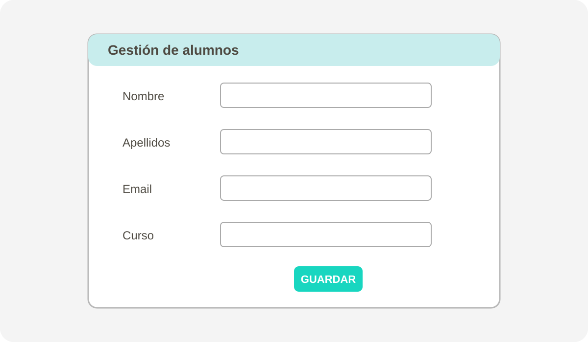

---

### Pregunta


¿Qué elementos necesitamos?

¿Una ventana? ¿Una escena? ¿Un contenedor? ¿Qué controles?

---

#  Crear el proyecto

1\. Crear proyecto Maven.

2\. Añadir JavaFX.

3\. Crear carpeta \`resources\`.

4\. Crear \`alumno.fxml\`.

5\. Abrirlo con Scene Builder.

**\*\*No programamos todavía la lógica.\*\***

Primero diseñamos.


---


# Diseña nuestro primer formulario

## Alta de alumno


---


### Componentes

- \`Label\`

- \`TextField\`

- \`ComboBox\`

- \`Button\`

- \`HBox\`

- \`VBox\` o \`GridPane\`

---


# 8.1 Configura los identificadores:

```text

Título       → lblTitulo

Nombre       → txtNombre

Apellidos    → txtApellidos

Email        → txtEmail

Curso        → cmbCurso

Guardar      → btnGuardar


```

Estos nombres nos permitirán conectar la interfaz con Java.

---


#  Guardar como FXML

Cuando guardamos el diseño obtenemos un archivo como:

```text

alumno.fxml

```

El archivo contiene XML.

Por ejemplo:

```xml

<VBox spacing="10">

    <Label text="Alta de alumno"/>

    <TextField fx\:id="txtNombre"/>

</VBox>

```

---


#  ¿Qué hemos conseguido?

```text

Scene Builder

      ↓

Diseño visual

      ↓

    FXML

      ↓

Estructura de la interfaz

```

Todavía falta:

```text

FXML

  ↓

Controller Java

  ↓

Eventos

```

Eso será el siguiente paso.

---


# Inspecciona el FXML

Abre el archivo \`.fxml\` con IntelliJ.

Busca:

- El contenedor raíz.

- Los \`Label\`.

- Los \`TextField\`.

- Los \`Button\`.

- Los \`fx\:id\`.

### Pregunta

¿Puedes localizar en el XML cada componente que aparece en Scene Builder?

---


Modifica tu formulario para añadir:

- \`DatePicker\` → fecha de nacimiento.

- \`ComboBox\` → ciclo.

- \`CheckBox\` → aceptar condiciones.

Después:

1\. Asigna los \`fx\:id\`.

2\. Guarda el FXML.

3\. Comprueba la jerarquía.

4\. Abre el FXML con el editor de código.

---


#  Dos herramientas, dos funciones

### Scene Builder

**\*\*Diseñar visualmente\*\***.

### IntelliJ IDEA

**\*\*Programar y comprender el código\*\***.

No debemos convertir Scene Builder en una caja negra.

\> **\*\*Si sabes diseñar pero no entiendes el FXML, todavía no controlas la interfaz.\*\***

---
# Solución MVC · Alta de alumno

La solución separa los datos del alumno, la vista diseñada en Scene Builder y la lógica que coordina el Controller.

```text
Modelo: Alumno.java
Vista: alumno.fxml
Controller: AlumnoController.java
Arranque: App.java
```

---

# Alta de alumno · Modelo

### `Alumno.java`

```java
package com.ejemplo;

public class Alumno {
    private final String nombre;
    private final String apellidos;
    private final String email;
    private final String curso;

    public Alumno(String nombre, String apellidos,
                  String email, String curso) {
        this.nombre = nombre;
        this.apellidos = apellidos;
        this.email = email;
        this.curso = curso;
    }

    public String getNombre() { return nombre; }
    public String getApellidos() { return apellidos; }
    public String getEmail() { return email; }
    public String getCurso() { return curso; }
}
```

El Modelo representa los datos del alumno; no depende de JavaFX.

---

# Alta de alumno · Vista FXML

### `src/main/resources/views/alumno.fxml`

```xml
<?import javafx.geometry.Insets?>
<?import javafx.scene.control.*?>
<?import javafx.scene.layout.*?>

<VBox spacing="12"
      xmlns="http://javafx.com/javafx"
      xmlns:fx="http://javafx.com/fxml/1"
      fx:controller="com.ejemplo.AlumnoController">
    <padding>
        <Insets top="20" right="20" bottom="20" left="20"/>
    </padding>
    <Label fx:id="lblTitulo" text="Alta de alumno"/>
    <GridPane hgap="10" vgap="10">
        <Label text="Nombre" GridPane.rowIndex="0"/>
        <TextField fx:id="txtNombre" GridPane.columnIndex="1"/>
        <Label text="Apellidos" GridPane.rowIndex="1"/>
        <TextField fx:id="txtApellidos" GridPane.rowIndex="1"
                   GridPane.columnIndex="1"/>
        <Label text="Email" GridPane.rowIndex="2"/>
        <TextField fx:id="txtEmail" GridPane.rowIndex="2"
                   GridPane.columnIndex="1"/>
        <Label text="Curso" GridPane.rowIndex="3"/>
        <ComboBox fx:id="cmbCurso" GridPane.rowIndex="3"
                  GridPane.columnIndex="1"/>
    </GridPane>

   ```

   ---
   ```

 
    <HBox spacing="10">
        <Button fx:id="btnGuardar" text="Guardar"
                onAction="#guardar"/>
        <Button text="Limpiar" onAction="#limpiar"/>
    </HBox>
    <Label fx:id="lblMensaje"/>
</VBox>
```

FXML describe la Vista y enlaza sus controles y eventos con el Controller.

---

# Alta de alumno · Controller

### `AlumnoController.java`

```java
package com.ejemplo;

import javafx.fxml.FXML;
import javafx.scene.control.ComboBox;
import javafx.scene.control.Label;
import javafx.scene.control.TextField;

public class AlumnoController {
    @FXML private TextField txtNombre;
    @FXML private TextField txtApellidos;
    @FXML private TextField txtEmail;
    @FXML private ComboBox<String> cmbCurso;
    @FXML private Label lblMensaje;

    @FXML
    private void initialize() {
        cmbCurso.getItems().setAll("DAM", "DAW", "ASIR");
    }

    @FXML
    private void guardar() {
        String nombre = txtNombre.getText().trim();
        String apellidos = txtApellidos.getText().trim();
        String email = txtEmail.getText().trim();
        String curso = cmbCurso.getValue();

        if (nombre.isEmpty() || apellidos.isEmpty()
                || email.isEmpty() || curso == null) {
            lblMensaje.setText("Completa todos los campos");
            return;
        }


```

---

```java
        Alumno alumno = new Alumno(nombre, apellidos, email, curso);
        lblMensaje.setText("Alumno creado: "
            + alumno.getNombre() + " " + alumno.getApellidos());
    }


    @FXML
    private void limpiar() {
        txtNombre.clear();
        txtApellidos.clear();
        txtEmail.clear();
        cmbCurso.getSelectionModel().clearSelection();
        lblMensaje.setText("");
    }
}
```

El Controller valida la entrada, crea el objeto Modelo y actualiza la Vista.

---

# Alta de alumno · Inicio de JavaFX

### `App.java`

```java
package com.ejemplo;

import java.io.IOException;
import javafx.application.Application;
import javafx.fxml.FXMLLoader;
import javafx.scene.Parent;
import javafx.scene.Scene;
import javafx.stage.Stage;

public class App extends Application {
    @Override
    public void start(Stage stage) throws IOException {
        Parent vista = FXMLLoader.load(
            getClass().getResource("/views/alumno.fxml"));
        stage.setTitle("Alta de alumno");
        stage.setScene(new Scene(vista, 560, 360));
        stage.show();
    }
}
```

Mantén `App`, `Alumno` y `AlumnoController` en el paquete `com.ejemplo`.

---


# ¿Qué ocurre en \`start()\`?

```java

public void start(Stage stage) {

```

JavaFX nos proporciona el \`Stage\` principal.

Después:

```java

Label lbl = new Label("Hola JavaFX");

```

Creamos un componente.

Y finalmente construimos la escena y mostramos la ventana.

---


# El flujo de nuestra primera aplicación

```text

crear Label

    ↓

crear contenedor

    ↓

crear Scene

    ↓

asociar Scene al Stage

    ↓

mostrar Stage

```

### Regla mental

\> **\*\*Crear → organizar → mostrar\*\***

---


# Nuestro primer Button

```java

Button btn = new Button("Aceptar");

```

Pero un botón sin evento no hace nada.

Necesitamos decirle:

\> "¿Qué tienes que hacer cuando te pulsen?"

---


#  Nuestro primer evento

```java

btn.setOnAction(e -> {

    System.out.println("Botón pulsado");

});

```

Flujo:

```text

Usuario

  ↓ clic

Button

  ↓

evento

código Java

  ↓

respuesta

```

---


# Primera interacción visual

Podemos modificar un \`Label\` desde el evento:

```java

Label lbl = new Label("Pulsa el botón");

Button btn = new Button("Aceptar");

btn.setOnAction(e -> {

    lbl.setText("¡Hola!");

});

```

Ahora la aplicación **\*\*responde dentro de la interfaz\*\***.

---


# Leer datos de un TextField

```java

TextField txtNombre = new TextField();

```

Para recuperar su contenido:

```java

String nombre = txtNombre.getText();

```

Y podemos utilizarlo:

```java

lbl.setText("Hola " + nombre);

```

---


# 9. Actividad 2 guiada · Saludador con Modelo, Vista y Controller

## Objetivo

Construir una primera aplicación pequeña **separando responsabilidades** desde el principio:

```text
MODELO
  ↓
Datos y comportamiento de la aplicación

VISTA
  ↓
Lo que ve y utiliza la persona usuaria

CONTROLLER
  ↓
Coordina la interacción entre Vista y Modelo
```

En esta primera práctica la interfaz se construirá con JavaFX desde código. **Todavía no utilizaremos FXML ni Scene Builder**; esos elementos aparecerán en la siguiente sesión.

---

# Paso 1 · Definir la aplicación

Queremos un pequeño **Saludador**.

La interfaz tendrá:

- Un `Label` que indique «Introduce tu nombre».
- Un `TextField` para escribir el nombre.
- Un `Button` «Saludar».
- Un `Label` para mostrar el resultado.

Resultado esperado:

```text
┌──────────────────────────────┐
│ Introduce tu nombre          │
│ [ Ana                    ]   │
│                              │
│          [ Saludar ]         │
│                              │
│ Hola, Ana                    │
└──────────────────────────────┘
```

---

# Paso 2 · MODELO

El **Modelo** no debe saber nada de botones, ventanas o `TextField`.

Su responsabilidad será trabajar con el dato y generar el saludo.

### `SaludoModel.java`

```java
public class SaludoModel {

    public String generarSaludo(String nombre) {
        return "Hola, " + nombre;
    }
}
```

### Comprueba

- ¿Dónde está el dato `nombre`?
- ¿El Modelo conoce `Button`?
- ¿El Modelo conoce `Label`?

**Respuesta:** no. El Modelo trabaja únicamente con la información y la lógica que necesita.

---

# Paso 3 · VISTA

La **Vista** contiene los elementos que verá la persona usuaria.

### `SaludoView.java`

```java
public class SaludoView {

    Label lblInstruccion = new Label("Introduce tu nombre");
    TextField txtNombre = new TextField();
    Button btnSaludar = new Button("Saludar");
    Label lblResultado = new Label();

    VBox root = new VBox(10,
        lblInstruccion,
        txtNombre,
        btnSaludar,
        lblResultado
    );
}
```

### Idea clave

La Vista **presenta la interfaz**. No debe decidir qué significa el saludo.

---

# Paso 4 · CONTROLLER

El **Controller** coordina la interacción.

Cuando el usuario pulsa el botón:

```text
Usuario
   ↓ clic
Vista
   ↓ evento
Controller
   ↓ pide el saludo
Modelo
   ↓ devuelve resultado
Controller
   ↓ actualiza
Vista
```

---

# Paso 5 · Crear el Controller

### `SaludoController.java`

```java
public class SaludoController {

    private final SaludoModel model;
    private final SaludoView view;

    public SaludoController(
            SaludoModel model,
            SaludoView view) {

        this.model = model;
        this.view = view;

        view.btnSaludar.setOnAction(e -> saludar());
    }

    private void saludar() {
        String nombre = view.txtNombre.getText();
        String resultado = model.generarSaludo(nombre);
        view.lblResultado.setText(resultado);
    }
}
```

**Observa:** el Controller no genera por sí mismo el texto del saludo. Se lo solicita al Modelo y después actualiza la Vista.

---

# Paso 6 · Conectar las tres partes

Ahora necesitamos una clase `App` que cree los objetos y los conecte.

### `App.java`

```java
public class App extends Application {

    @Override
    public void start(Stage stage) {

        SaludoModel model = new SaludoModel();
        SaludoView view = new SaludoView();
        new SaludoController(model, view);

        Scene scene = new Scene(view.root, 400, 250);

        stage.setTitle("Saludador");
        stage.setScene(scene);
        stage.show();
    }
}
```

---

# Paso 7 · Probar la aplicación

Realiza estas pruebas en orden:

1. Ejecuta la aplicación.
2. Comprueba que aparece la ventana.
3. Escribe `Ana`.
4. Pulsa **Saludar**.
5. Comprueba que aparece `Hola, Ana`.
6. Prueba con otro nombre.

### Después pregunta

- ¿Qué clase representa el Modelo?
- ¿Qué clase construye la interfaz?
- ¿Qué clase recibe el clic?
- ¿Qué clase decide cómo se genera el saludo?

---

# Paso 8 · Mejorar el Modelo

Ahora modifica el Modelo para evitar saludos vacíos.

```java
public String generarSaludo(String nombre) {

    if (nombre == null || nombre.isBlank()) {
        return "El nombre es obligatorio";
    }

    return "Hola, " + nombre.trim();
}
```

### Observa la separación

La regla de validación relacionada con el dato está en el **Modelo**.

El Controller sigue coordinando.

La Vista sigue mostrando los controles.

---

# Paso 9 · Identificar MVC en el proyecto

Completa esta tabla en tu cuaderno:

| Elemento | Responsabilidad |
|---|---|
| `SaludoModel` | Datos y lógica del saludo |
| `SaludoView` | Interfaz que ve el usuario |
| `SaludoController` | Coordina eventos y comunicación |
| `App` | Arranca y conecta la aplicación |

### Regla para recordar

> **Modelo = qué datos/lógica tenemos · Vista = qué mostramos · Controller = cómo coordinamos la interacción**


---


# Comprobación guiada · Validación

¿Qué ocurre si el usuario pulsa **\*\*Saludar\*\*** sin escribir nada?

Queremos evitarlo.

```java

if (txtNombre.getText().isEmpty()) {

    lblResultado.setText("El nombre es obligatorio");

} else {

    lblResultado.setText(

        "Hola " + txtNombre.getText());

}

```

### Concepto nuevo

**\*\*Validar antes de procesar.\*\***

---


# Reto: Ampliar el MVC

Mejora el saludador:

- Añade botón **\*\*Limpiar\*\***.

- Añade botón **\*\*Salir\*\***.

- Cambia el título de la ventana.

- Añade un mensaje inicial.

- Evita aceptar espacios como nombre.

### Extra

¿Puedes hacer que al pulsar \`Enter\` se ejecute el saludo?

---


# ¿Qué debemos haber aprendido?

Al terminar la sesión 1 debemos poder explicar:

- ¿Qué es un \`Stage\`?

- ¿Qué es una \`Scene\`?

- ¿Qué es un \`Node\`?

- ¿Qué hace un \`Button\`?

- ¿Cómo se captura un clic?

- ¿Cómo obtenemos el texto de un \`TextField\`?

- ¿Por qué utilizamos layouts?

---
# 10. FXML: describir la interfaz
---

# 10.1 FXML y separación de responsabilidades

## ¿Qué es FXML?

FXML es un lenguaje basado en XML que describe la estructura de una interfaz JavaFX.

```xml

<VBox>

    <Label text="Nombre"/>

    <TextField fx\:id="txtNombre"/>

    <Button text="Guardar"/>

</VBox>

```

FXML responde principalmente a:

\> **\*\*¿Qué componentes hay y cómo están organizados?\*\***

---


# 10.2 FXML · Java · CSS

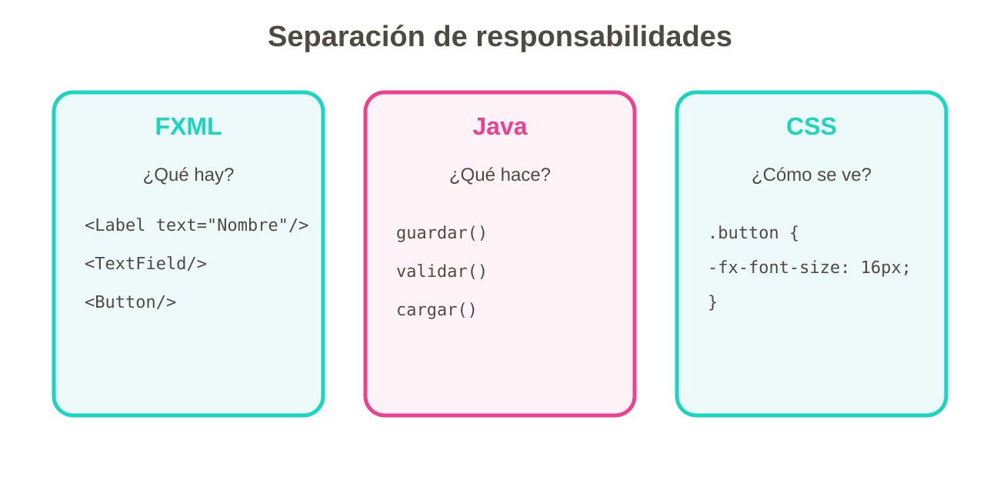

---


# 10.3 \`fx\:id\`

```xml

<TextField fx\:id="txtNombre"/>

```

Y en Java:

```java

@FXML

private TextField txtNombre;

```

Esto permite que el controlador tenga acceso al componente.

---


# 10.4 Eventos desde FXML

Podemos indicar en FXML qué método responde al botón:

```xml

<Button text="Guardar"

        onAction="#guardar"/>

```

Y en Java:

```java

@FXML

private void guardar() {

    // acción

}

```

---


# 10.5 FXML · comprender el documento

##  Estructura básica

Un FXML puede comenzar así:

```xml
<?xml version="1.0" encoding="UTF-8"?>

<?import javafx.scene.control.Button?>
<?import javafx.scene.layout.VBox?>

<VBox
    xmlns="http://javafx.com/javafx"
    xmlns:fx="http://javafx.com/fxml/1">

    <children>
        <Button text="Aceptar"/>
    </children>
</VBox>
```

No es necesario memorizarlo, pero sí saber **interpretarlo**.

---


# 10.6 Imports

Los imports indican las clases JavaFX utilizadas.

```xml
<?import javafx.scene.control.Button?>
<?import javafx.scene.control.Label?>
<?import javafx.scene.layout.VBox?>
```

Scene Builder puede generarlos automáticamente.

---

# 10.7 El nodo raíz

Todo FXML necesita una raíz.

Ejemplo:

```xml
<VBox>
    ...
</VBox>
```

La raíz puede ser:

```text
VBox
BorderPane
GridPane
AnchorPane
StackPane
TabPane
```

según el diseño.

---


# 10.8 `fx:controller`

Indica qué clase Java controla la vista.

```xml
<VBox
    xmlns:fx="http://javafx.com/fxml/1"
    fx:controller="com.ejemplo.AlumnoController">
```

La relación es:

```text
alumno.fxml
      │
      │ fx:controller
      ▼
AlumnoController.java
```

---


# 10.9 FXMLLoader

JavaFX utiliza `FXMLLoader` para cargar el FXML.

```java
FXMLLoader loader =
    new FXMLLoader(
        getClass().getResource("alumno.fxml")
    );

Parent root = loader.load();
```

Después:

```java
Scene scene = new Scene(root);
stage.setScene(scene);
stage.show();
```

### Flujo

```text
FXML
 ↓
FXMLLoader
 ↓
árbol de Nodes
 ↓
Scene
 ↓
Stage
```

---


# 10.10 `@FXML`

La anotación `@FXML` permite indicar elementos o métodos que serán utilizados desde FXML.

```java
@FXML
private TextField txtNombre;
```

Y para un evento:

```java
@FXML
private void guardar() {
    ...
}
```

---
# 11. Controller: conectar la interfaz con Java
---


# 11.1 Controller · la lógica de la vista

## ¿Qué es un Controller?

Es la clase Java que coordina la interacción de una vista FXML.

```text
FXML
 │
 │ fx:id / onAction
 ▼
Controller
 │
 ├── lee datos
 ├── valida
 ├── cambia controles
 └── ejecuta acciones
```

---


# 11.2 Ejemplo completo

FXML:

```xml
<VBox
    xmlns:fx="http://javafx.com/fxml/1"
    fx:controller="com.ejemplo.AlumnoController">

    <TextField fx:id="txtNombre"/>

    <Label fx:id="lblResultado"/>

    <Button
        text="Guardar"
        onAction="#guardar"/>
</VBox>
```
---


Controller:

```java
public class AlumnoController {

    @FXML
    private TextField txtNombre;

    @FXML
    private Label lblResultado;

    @FXML
    private void guardar() {

        String nombre =
            txtNombre.getText().trim();

        if (nombre.isEmpty()) {
            lblResultado.setText(
                "El nombre es obligatorio");
            return;
        }

        lblResultado.setText(
            "Alumno: " + nombre);
    }
}
```

---


# 11.3 `initialize()`

El controlador puede tener un método de inicialización.

```java
@FXML
public void initialize() {

    cmbCurso.getItems().addAll(
        "DAM",
        "DAW",
        "ASIR"
    );
}
```

Se ejecuta cuando el FXML ya ha sido cargado y los elementos inyectados.

### Uso habitual

- cargar opciones;
- establecer valores iniciales;
- configurar listeners;
- preparar tablas;
- configurar estados iniciales.

---


# 11.4 No meter todo en `initialize()`

`initialize()` no debe convertirse en un método gigante.

❌

```java
initialize() {
    cargarTodo();
    validarTodo();
    guardarTodo();
    abrirVentanas();
    ...
}
```

✅ Mejor separar responsabilidades:

```java
initialize() {
    configurarCombo();
    configurarTabla();
    configurarEstadoInicial();
}
```

---


# 11.5 Controller y modelo

En aplicaciones reales podemos separar:

```text
Vista
 ↓
Controller
 ↓
Modelo / servicios
 ↓
Datos
```

Por ejemplo:

```java
public class Persona {

    private String nombre;
    private String email;

    // constructor, getters y setters
}
```

El controller se ocupa de coordinar la interfaz, no de convertir toda la aplicación en una única clase enorme.

---


# 11.6 FXML ↔ Controller · conexión completa

## 11.6.1 El circuito

```text
        Scene Builder
             ↓
            FXML
             ↓
       fx:controller
             ↓
        Controller
             ↑
          fx:id
             ↑
          controles
```

---


# 11.7 Error: `fx:id` que no coincide

FXML:

```xml
<TextField fx:id="txtNombre"/>
```

Controller:

```java
@FXML
private TextField txtAlumno;
```

❌ Los nombres no coinciden.

Debe ser:

```java
@FXML
private TextField txtNombre;
```

---


# 11.8 Error: controlador incorrecto

FXML:

```xml
fx:controller="com.ejemplo.AlumnoController"
```

Si la clase no existe en ese paquete, la carga puede fallar.

### Comprobación

```text
src/main/java
└── com
    └── ejemplo
        └── AlumnoController.java
```

Y:

```java
package com.ejemplo;
```

---


# 11.9 Error: método de evento inexistente

FXML:

```xml
<Button onAction="#guardar"/>
```

Controller:

```java
@FXML
private void guardar() {
}
```

Si el método no existe o no puede resolverse correctamente, el FXML no funcionará como esperamos.

> **Cada conexión FXML ↔ Controller debe poder rastrearse.**

---


# 11.10 Errores de carga FXML

Cuando aparece una excepción como:

```text
LoadException
```

debemos revisar:

1. ruta del FXML;
2. `fx:controller`;
3. `fx:id`;
4. métodos `onAction`;
5. imports;
6. nombres de clases;
7. tipos de controles;
8. estructura XML.

### Técnica de depuración

```text
¿Dónde falla?
   ↓
Lee la línea indicada
   ↓
Busca el elemento FXML
   ↓
Comprueba controller / id / método
```

---
# 12. Eventos e interacción
---


# 12.1 Eventos e interacción

## ¿Qué es un evento?

Un evento es algo que ocurre durante la interacción con la aplicación.

Ejemplos:

- Clic.

- Tecla pulsada.

- Cambio de selección.

- Cambio de texto.

- Movimiento del ratón.

---


# 12.2 El ciclo de una interacción

```text

Usuario

   ↓

Acción

   ↓

Evento

   ↓

Controlador

   ↓

Lógica

   ↓

Respuesta

```

Una interfaz gráfica cobra sentido cuando **\*\*responde a las acciones del usuario\*\***.

---


# 12.3 Leer y validar datos

```java

String nombre = txtNombre.getText().trim();

if (nombre.isEmpty()) {

    lblMensaje.setText("El nombre es obligatorio");

    return;

}

lblMensaje.setText("Alumno: " + nombre);

```

### Idea importante

**\*\*La interfaz recoge datos; el código decide qué hacer con ellos.\*\***

---


# 12.4 Eventos · mucho más que `onAction`

## Eventos habituales

Podemos trabajar con:

```text
ActionEvent
MouseEvent
KeyEvent
```

y cambios de propiedades mediante listeners.

---


# 12.5 Evento de botón

```java
btnGuardar.setOnAction(event -> {
    guardar();
});
```

Desde FXML:

```xml
<Button
    text="Guardar"
    onAction="#guardar"/>
```

---


# 12.6 Evento de teclado

Ejemplo conceptual:

```java
txtNombre.setOnKeyPressed(event -> {

    if (event.getCode() == KeyCode.ENTER) {
        guardar();
    }
});
```

Necesitamos:

```java
import javafx.scene.input.KeyCode;
```

---


# 12.7 Evento de ratón

```java
btn.setOnMouseEntered(event -> {
    System.out.println("Ratón encima");
});
```

Otros eventos:

```text
onMouseClicked
onMousePressed
onMouseReleased
onMouseEntered
onMouseExited
```

> Para acciones normales de botones, `onAction` suele expresar mejor la intención que un evento de ratón.

---
# 12.8 Cambio de selección

Por ejemplo, una tabla:

```java
tabla.getSelectionModel()
     .selectedItemProperty()
     .addListener(
         (obs, anterior, actual) -> {

             if (actual != null) {
                 cargarPersona(actual);
             }
         });
```

Esto permite construir interfaces de gestión:

```text
Seleccionar fila
      ↓
Cargar datos
      ↓
Modificar / eliminar
```

---


# 12.9 Eventos y listeners

Un listener observa cambios.

```java
txtNombre.textProperty()
    .addListener((obs, anterior, nuevo) -> {

        lblContador.setText(
            String.valueOf(nuevo.length())
        );
    });
```

Esto es diferente de ejecutar código únicamente al pulsar un botón.

---
# 13. Validación
---


# 13.1 Validación · hacer interfaces robustas

## Validar no es solo comprobar `isEmpty()`

Una aplicación debe comprobar:

```text
¿Existe el dato?
      ↓
¿Tiene el formato correcto?
      ↓
¿Está dentro del rango?
      ↓
¿Es coherente con otros datos?
```

---


# 13.2 Validación de texto

```java
String nombre = txtNombre.getText().trim();

if (nombre.isEmpty()) {
    mostrarError("El nombre es obligatorio");
    return;
}
```

---


# 13.3 Validación de números

No debemos hacer directamente:

```java
int edad =
    Integer.parseInt(txtEdad.getText());
```

sin controlar errores.

Mejor:

```java
try {

    int edad =
        Integer.parseInt(
            txtEdad.getText().trim()
        );

    if (edad < 0 || edad > 120) {
        mostrarError("Edad no válida");
        return;
    }

} catch (NumberFormatException e) {

    mostrarError("La edad debe ser numérica");
}
```

---


# 13.4 Validación de email

Una comprobación sencilla:

```java
String email = txtEmail.getText().trim();

if (email.isEmpty()) {
    mostrarError("El email es obligatorio");
    return;
}

if (!email.contains("@")) {
    mostrarError("El email no parece válido");
    return;
}
```

> Para aplicaciones reales pueden utilizarse validaciones más completas. En esta unidad importa comprender el principio: **no confiar ciegamente en la entrada del usuario**.

---


# 13.5 Validación de varios campos

Ejemplo:

```java
String nombre = txtNombre.getText().trim();
String email = txtEmail.getText().trim();

if (nombre.isEmpty()) {
    mostrarError("Introduce el nombre");
    txtNombre.requestFocus();
    return;
}

if (email.isEmpty()) {
    mostrarError("Introduce el email");
    txtEmail.requestFocus();
    return;
}

guardar();
```

---


# 13.6 Validación visual con CSS

Podemos utilizar una clase para indicar error:

```css
.error {
    -fx-border-color: red;
}
```

Java:

```java
txtNombre.getStyleClass().add("error");
```

Para quitarla:

```java
txtNombre.getStyleClass().remove("error");
```

Así podemos distinguir:

```text
estado normal
estado con error
estado válido
```

---
# 14. Alert y diálogos
---


# 14.1 Alert y diálogos

##  ¿Qué es un diálogo?

Es una ventana que comunica algo o solicita una decisión.

JavaFX proporciona:

```text
Alert
TextInputDialog
ChoiceDialog
```

---


# 14.2 Alert de información

```java
Alert alert = new Alert(
    Alert.AlertType.INFORMATION
);

alert.setTitle("Información");
alert.setHeaderText(null);
alert.setContentText(
    "Alumno guardado correctamente"
);

alert.showAndWait();
```

---
# 14.3 Alert de error

```java
Alert alert = new Alert(
    Alert.AlertType.ERROR
);

alert.setTitle("Error");
alert.setHeaderText("Datos incorrectos");
alert.setContentText(
    "Revisa los campos del formulario."
);

alert.showAndWait();
```

---


# 14.4 Confirmación

Para preguntar antes de eliminar:

```java
Alert alert = new Alert(
    Alert.AlertType.CONFIRMATION
);

alert.setTitle("Confirmar");
alert.setHeaderText("Eliminar alumno");
alert.setContentText(
    "¿Deseas eliminar el registro?"
);

Optional<ButtonType> resultado =
    alert.showAndWait();

if (resultado.isPresent()
    && resultado.get() == ButtonType.OK) {

    eliminar();
}
```

---


# 14.5 `TextInputDialog`

Permite pedir un dato sencillo.

```java
TextInputDialog dialog =
    new TextInputDialog();

dialog.setTitle("Nuevo curso");
dialog.setHeaderText(
    "Introduce el nombre del curso"
);

Optional<String> resultado =
    dialog.showAndWait();
```

---

# 14.6 ¿Cuándo utilizar cada uno?

| Situación | Solución |
|---|---|
| Información | `INFORMATION` |
| Error | `ERROR` |
| Advertencia | `WARNING` |
| Confirmación | `CONFIRMATION` |
| Introducir un dato | `TextInputDialog` |

> Un diálogo debe aparecer cuando aporta información o requiere una decisión; no debemos llenar la aplicación de ventanas emergentes innecesarias.

---
# 15. CSS en JavaFX
---


# 15.1 CSS en JavaFX

##  ¿Por qué CSS?

Queremos separar:

- Estructura → FXML.

- Comportamiento → Java.

- Apariencia → CSS.

Ejemplo:

```css

.titulo {

    -fx-font-size: 24px;

    -fx-font-weight: bold;

}

```

---


# 15.2 Aplicar una clase CSS

FXML:

```xml

<Label text="Gestión de alumnos"

       styleClass="titulo"/>

```

CSS:

```css

.titulo {

    -fx-font-size: 24px;

    -fx-font-weight: bold;

}

```

La apariencia puede cambiar sin modificar la lógica Java.

---


# 15.3 CSS JavaFX · profundización

## Cargar una hoja de estilos

```java
scene.getStylesheets().add(
    getClass()
        .getResource("/css/estilos.css")
        .toExternalForm()
);
```

---


# 15.4 Selectores

### Por clase

```css
.boton-principal {
    -fx-font-size: 16px;
}
```

### Por `id`

```css
#btnGuardar {
    -fx-font-weight: bold;
}
```

### Por tipo

```css
.button {
    -fx-background-radius: 8px;
}
```

---


# 15.5 Pseudoclases

JavaFX dispone de estados visuales.

Ejemplo:

```css
.button:hover {
    -fx-opacity: 0.8;
}
```

También podemos trabajar con estados como:

```css
.text-field:focused {
    -fx-border-width: 2px;
}
```

La interfaz puede reaccionar visualmente al estado del control sin programar un evento específico para cada cambio visual.

---


# 15.6 CSS y estados de validación

```css
.error {
    -fx-border-color: red;
    -fx-border-width: 2px;
}

.correcto {
    -fx-border-color: green;
}
```

Java:

```java
txtEmail.getStyleClass()
        .add("error");
```

---


# 15.7 CSS externo frente a estilo inline

### Inline

```xml
style="-fx-font-size: 20px;"
```

### Externo

```css
.titulo {
    -fx-font-size: 20px;
}
```

Para proyectos medianos y grandes:

> **Preferimos CSS externo y clases reutilizables.**

---
# 16. Navegación entre pantallas
---


# 16.1 Navegación entre pantallas

## Una aplicación real tiene más de una vista

Ejemplo:

```text
Login
  ↓
Principal
  ├── Alumnos
  ├── Cursos
  └── Configuración
```

Cada pantalla puede tener su propio:

```text
FXML
Controller
CSS compartido
```

---


# 16.2 Cambiar la vista en la misma ventana

Podemos cargar otro FXML:

```java
FXMLLoader loader =
    new FXMLLoader(
        getClass().getResource(
            "/views/alumnos.fxml"
        )
    );

Parent root = loader.load();

Stage stage =
    (Stage) btnAlumnos.getScene().getWindow();

stage.setScene(new Scene(root));
stage.show();
```

---


# 16.3 Crear un método de navegación

Es mejor centralizar la navegación cuando el proyecto crece.

```java
private void cambiarVista(
        String recurso) throws IOException {

    Parent root =
        FXMLLoader.load(
            getClass().getResource(recurso)
        );

    Stage stage =
        (Stage) btn.getScene()
                   .getWindow();

    stage.setScene(new Scene(root));
}
```

Uso:

```java
cambiarVista("/views/alumnos.fxml");
```

---


# 16.4 ¿Nueva ventana o misma ventana?

### Misma ventana

Adecuada para:

```text
Login → Principal → Alumnos
```

### Nueva ventana

Puede ser adecuada para:

```text
Principal → Acerca de
Principal → Configuración
Principal → Edición independiente
```

La decisión depende del flujo de la aplicación.

---
# 16.5 Navegación con `BorderPane`

Una estrategia muy útil es mantener una ventana principal:

```text
BorderPane
├── TOP    → menú
├── LEFT   → navegación
├── CENTER → vista actual
└── BOTTOM → información
```

El contenido central cambia:

```java
borderPane.setCenter(nuevaVista);
```

Esto permite crear una aplicación con estructura estable y contenido dinámico.

---


# 16.6 Ejemplo de menú lateral

```text
┌──────────────────────────────────────┐
│              CABECERA                │
├──────────────┬───────────────────────┤
│ [Alumnos]    │                       │
│ [Cursos]     │       CONTENIDO       │
│ [Config.]    │                       │
│              │                       │
├──────────────┴───────────────────────┤
│              PIE                      │
└──────────────────────────────────────┘
```

La selección de cada botón modifica el `CENTER`.

---
# 17. Accesibilidad y usabilidad
---


# 17.1 Accesibilidad y usabilidad

##  Una interfaz no debe funcionar solo "técnicamente"

También debe ser comprensible y utilizable.

Debemos cuidar:

- textos claros;
- orden lógico de los campos;
- tamaño adecuado;
- contraste;
- mensajes de error comprensibles;
- navegación por teclado;
- no depender exclusivamente del color;
- botones con acciones claras.

---


# 17.2 Labels y campos

Es preferible:

```text
Nombre:
[________________]
```

frente a:

```text
[________________]
```

El usuario debe saber qué información introducir.

---


# 17.3 PromptText no sustituye siempre a Label

```xml
<TextField promptText="Introduce tu nombre"/>
```

Puede ser útil como ayuda, pero el `Label` sigue siendo importante cuando necesitamos que la identificación del campo permanezca visible.

---


# 17.4 Orden de navegación

Debemos comprobar que la aplicación puede utilizarse con teclado.

Ejemplo:

```text
Nombre
   ↓ Tab
Email
   ↓ Tab
Curso
   ↓ Tab
Guardar
```

> Probar una interfaz únicamente con ratón deja fuera una parte importante de la experiencia de uso.

---
# 18. Arquitectura básica
---


# 18.1 Arquitectura básica de una aplicación JavaFX

##  Organización recomendada

```text
src/main
├── java
│   └── com.ejemplo
│       ├── App.java
│       ├── controller
│       │   ├── LoginController.java
│       │   └── AlumnoController.java
│       └── model
│           └── Alumno.java
│
└── resources
    ├── views
    │   ├── login.fxml
    │   ├── principal.fxml
    │   └── alumnos.fxml
    ├── css
    │   └── estilos.css
    └── img
        └── logo.png
```

---


# 18.2 Responsabilidades

```text
App
 ↓
arranca la aplicación

FXML
 ↓
describe la vista

Controller
 ↓
coordina interacción

Model
 ↓
representa los datos

CSS
 ↓
define apariencia
```

---


# 18.3 Lo que debemos evitar

❌ Una única clase de 1.500 líneas.

❌ Todo el diseño escrito manualmente en Java.

❌ Todo el estilo mediante `setStyle()`.

❌ Acceder a componentes que no están en el FXML.

❌ Mezclar navegación, validación, modelo y estilos sin organización.

---
# 19. Proyecto de la unidad
---


# 19.1 Proyecto de la unidad

## Gestor de alumnos

La aplicación integrará todo lo aprendido.

```text

LOGIN

  ↓

MENÚ PRINCIPAL

  ├── Alumnos

  ├── Cursos

  └── Configuración

```

La pantalla de alumnos utilizará formularios, controles, eventos, FXML y CSS.

---


# 19.2 Requisitos mínimos

La aplicación debe incluir:

- Al menos **\*\*2 pantallas\*\***.

- Scene Builder.

- FXML.

- Al menos **\*\*5 tipos de componentes\*\***.

- Layouts correctamente utilizados.

- Eventos.

- Validación básica.

- CSS externo.

- Código Java organizado.

---


# 19.3 ¿Qué se evaluará?

| Aspecto | Qué buscamos |
|---|---|
| Diseño | Interfaz clara y usable |
| Componentes | Elección adecuada |
| Layouts | Distribución adaptable |
| FXML | Comprensión y uso correcto |
| Java | Código organizado |
| Eventos | Respuesta correcta |
| CSS | Estilo coherente |
| Proyecto | Funcionamiento global |

---
# 20. Proyecto integrador · Gestor de alumnos
---


# 20.1 Proyecto integrador · Gestor de alumnos

## Objetivo

Construir una aplicación que integre los 14 bloques de la UD1.

```text
┌───────────────┐
│     LOGIN     │
└───────┬───────┘
        ↓
┌─────────────────────────────┐
│       PRINCIPAL             │
├──────────┬──────────────────┤
│ Alumnos  │ Cursos           │
│          │ Configuración    │
└────┬─────┴──────────────────┘
     ↓
┌─────────────────────────────┐
│       GESTIÓN ALUMNOS       │
├─────────────────────────────┤
│ Nombre   [______________]   │
│ Email    [______________]   │
│ Curso    [ DAM ▼       ]    │
│ Fecha    [__/__/____   ]    │
│                             │
│ [Guardar] [Modificar]       │
│ [Eliminar] [Limpiar]        │
├─────────────────────────────┤
│           TABLEVIEW         │
└─────────────────────────────┘
```

---


# 20.2 Requisitos funcionales

La aplicación deberá permitir:

1. Acceder mediante una pantalla de login.
2. Mostrar una pantalla principal.
3. Navegar entre diferentes vistas.
4. Crear alumnos.
5. Validar los datos.
6. Mostrar los alumnos en una `TableView`.
7. Seleccionar un alumno.
8. Cargar sus datos en el formulario.
9. Modificarlo.
10. Eliminarlo solicitando confirmación.
11. Limpiar el formulario.
12. Mostrar mensajes mediante `Alert`.
13. Aplicar CSS externo.

---


# 20.3 Controles mínimos

Debe utilizarse como mínimo:

```text
Label
TextField
PasswordField
ComboBox
DatePicker
Button
CheckBox o RadioButton
TableView
Alert
```

Además de varios layouts.

---


# 20.4 Vistas mínimas

```text
login.fxml
principal.fxml
alumnos.fxml
```

Opcional:

```text
cursos.fxml
configuracion.fxml
acerca.fxml
```

---


# 20.5 Controllers

```text
LoginController
PrincipalController
AlumnosController
```

Cada controlador debe tener una responsabilidad clara.

---


# 20.6 Modelo

Ejemplo:

```java
public class Alumno {

    private String nombre;
    private String apellidos;
    private String email;
    private String curso;
    private LocalDate fechaNacimiento;

    public Alumno(
            String nombre,
            String apellidos,
            String email,
            String curso,
            LocalDate fechaNacimiento) {

        this.nombre = nombre;
        this.apellidos = apellidos;
        this.email = email;
        this.curso = curso;
        this.fechaNacimiento = fechaNacimiento;
    }
}
```

---


# 20.7 ObservableList

Para mantener los datos de la tabla:

```java
private final ObservableList<Alumno> alumnos =
    FXCollections.observableArrayList();
```

Añadir:

```java
alumnos.add(nuevoAlumno);
```

Eliminar:

```java
alumnos.remove(alumnoSeleccionado);
```

La `TableView` puede utilizar esta lista como fuente de datos.

---


# 20.8 TableView · conexión con el modelo

Conceptualmente:

```text
ObservableList<Alumno>
          ↓
      TableView
          ↓
   TableColumn
          ↓
     propiedades
```

Una columna puede mostrar:

```java
TableColumn<Alumno, String> nombreColumna;
```

Y asociarse a una propiedad del objeto.

---


# 20.9 Selección de una fila

```java
Alumno seleccionado =
    tabla.getSelectionModel()
         .getSelectedItem();
```

Si existe:

```java
if (seleccionado != null) {

    txtNombre.setText(
        seleccionado.getNombre()
    );
}
```

---


# 20.10 Eliminar con confirmación

```text
Seleccionar alumno
       ↓
Pulsar Eliminar
       ↓
Confirmación
   ↙          ↘
Cancelar      Aceptar
                 ↓
             eliminar
```

Esto integra:

- selección;
- evento;
- diálogo;
- modificación de datos;
- actualización de la interfaz.

---


# 20.11 Integración de todos los bloques

## La cadena completa

```text
1. JavaFX
     ↓
2. Scene Builder
     ↓
3. Layouts
     ↓
4. Controles + propiedades
     ↓
5. FXML
     ↓
6. CSS
     ↓
7. fx:id
     ↓
8. Eventos
     ↓
9. Controller
     ↓
10. FXML ↔ Controller
     ↓
11. Validación
     ↓
12. Alert / diálogos
     ↓
13. Navegación
     ↓
14. Proyecto integrador
```

---


# 20.12 Ejemplo de flujo real

```text
Usuario escribe nombre
          ↓
TextField
          ↓
fx:id
          ↓
Controller
          ↓
Evento Guardar
          ↓
Validación
          ↓
¿Correcto?
     ↙           ↘
   NO             SÍ
   ↓              ↓
 Alert         Crear Alumno
                  ↓
              TableView
```

---
# 21. Errores típicos y diagnóstico
---


# 21.1 Errores típicos y cómo diagnosticarlos

##  La ventana no aparece

Comprobar:

```text
¿se ejecuta start()?
¿se crea Scene?
¿se asigna Scene al Stage?
¿se llama stage.show()?
```

---


# 21.2 `NullPointerException` en un control `@FXML`

Revisar:

```text
FXML fx:id
       ↕
Controller @FXML
```

Ejemplo:

```xml
fx:id="txtNombre"
```

debe corresponder a:

```java
@FXML
private TextField txtNombre;
```

---


# 21.3 `LoadException`

Revisar:

```text
fx:controller
onAction
imports
XML
rutas
nombres de clases
```

---


# 21.4 CSS no se aplica

Comprobar:

1. ¿El archivo existe?
2. ¿La ruta es correcta?
3. ¿La hoja se ha añadido a la `Scene`?
4. ¿El `styleClass` coincide?
5. ¿El selector CSS está escrito correctamente?

Ejemplo:

```java
scene.getStylesheets().add(
    getClass()
        .getResource("/css/estilos.css")
        .toExternalForm()
);
```

---


# 21.5 El botón no hace nada

Comprobar:

```xml
onAction="#guardar"
```

y:

```java
@FXML
private void guardar() {
}
```

Después revisar la consola de ejecución.

---


# 21.6 La interfaz se rompe al cambiar el tamaño

Revisar:

```text
¿Estoy usando layouts?
¿He fijado demasiados tamaños?
¿He utilizado posiciones rígidas?
¿He configurado correctamente HBox/VBox/GridPane?
¿Los elementos pueden crecer?
```

---
# 22. Actividades y evaluación
---


# 22.1 Actividades y evaluación

## Checklist individual

Antes de entregar el proyecto, comprueba:

### JavaFX

- [ ] El proyecto se ejecuta.
- [ ] La ventana aparece correctamente.
- [ ] La `Scene` está configurada.

### Scene Builder

- [ ] La interfaz está diseñada con Scene Builder.
- [ ] La jerarquía es coherente.
- [ ] Se utilizan layouts.

### FXML

- [ ] Cada vista tiene un FXML.
- [ ] `fx:controller` es correcto.
- [ ] Los `fx:id` son correctos.


---


### Controller

- [ ] Los controles están inyectados.
- [ ] Los métodos de eventos funcionan.
- [ ] `initialize()` se utiliza cuando es necesario.

### CSS

- [ ] Existe CSS externo.
- [ ] Las clases se aplican correctamente.
- [ ] La interfaz tiene un estilo coherente.

### Validación

- [ ] No se aceptan campos obligatorios vacíos.
- [ ] Los números se validan.
- [ ] Los errores se comunican claramente.

### Diálogos

- [ ] Los errores importantes se comunican.
- [ ] Las eliminaciones piden confirmación.

### Navegación

- [ ] Se puede acceder a las diferentes pantallas.
- [ ] La aplicación no abre ventanas innecesarias.
- [ ] Existe una forma clara de volver.

---


# 22.2 Práctica guiada · de cero a aplicación

## Fase 1 · Diseño

Crear:

```text
login.fxml
principal.fxml
alumnos.fxml
```

Utilizar Scene Builder.

**Objetivo:** terminar primero la estructura visual.

---


# 22.3 Fase 2 · Identificadores

Asignar:

```text
txtUsuario
txtPassword
btnLogin

btnAlumnos
btnCursos
btnSalir

txtNombre
txtApellidos
txtEmail
cmbCurso
dpNacimiento

btnGuardar
btnModificar
btnEliminar
btnLimpiar

tablaAlumnos
```

---


# 22.4 Fase 3 · CSS

Crear:

```text
src/main/resources/css/estilos.css
```

Definir como mínimo:

```css
.root {
    -fx-font-family: "Segoe UI";
}

.titulo {
    -fx-font-size: 24px;
    -fx-font-weight: bold;
}

.error {
    -fx-border-color: red;
}
```

---


# 22.5 Fase 4 · Controllers

Crear:

```text
LoginController.java
PrincipalController.java
AlumnosController.java
```

Cada uno debe controlar su propia vista.

---


# 22.6 Fase 5 · Eventos

Programar:

```text
Login
 ↓
Principal

Alumnos
 ↓
Formulario

Guardar
 ↓
Validar
 ↓
Añadir

Seleccionar
 ↓
Cargar

Modificar
 ↓
Actualizar

Eliminar
 ↓
Confirmar
 ↓
Eliminar
```

---


# 22.7 Fase 6 · Validación

Casos mínimos:

```text
Nombre vacío
Email vacío
Email incorrecto
Curso no seleccionado
Fecha no seleccionada
```

Cada error debe proporcionar una respuesta comprensible.

---


# 22.8 Fase 7 · Pruebas

Probar:

1. Datos correctos.
2. Campos vacíos.
3. Datos incorrectos.
4. Cancelación de eliminación.
5. Confirmación de eliminación.
6. Modificación.
7. Navegación.
8. Redimensionamiento de ventana.
9. Uso con teclado.
10. Cierre de la aplicación.

---


# 22.9 Preguntas de repaso

## Conceptos

1. ¿Qué diferencia existe entre `Stage`, `Scene` y `Node`?
2. ¿Qué función cumple Scene Builder?
3. ¿Qué es FXML?
4. ¿Qué responsabilidad tiene un Controller?
5. ¿Qué diferencia hay entre `id` y `fx:id`?
6. ¿Para qué sirve `FXMLLoader`?
7. ¿Qué hace `@FXML`?
8. ¿Qué es `initialize()`?
9. ¿Qué es un evento?
10. ¿Qué diferencia existe entre un evento y un listener?

---


# 22.10 Preguntas sobre layouts

11. ¿Cuándo utilizarías `VBox`?
12. ¿Cuándo utilizarías `HBox`?
13. ¿Para qué sirve `GridPane`?
14. ¿Qué estructura proporciona `BorderPane`?
15. ¿Qué diferencia conceptual existe entre `StackPane` y `VBox`?
16. ¿Por qué debemos evitar interfaces basadas únicamente en posiciones?

---


# 22.11 Preguntas sobre FXML

17. ¿Qué función tiene `fx:controller`?
18. ¿Cómo se conecta un `TextField` con un atributo del Controller?
19. ¿Cómo se conecta un botón con un método?
20. ¿Qué ocurre si el método indicado en `onAction` no existe?

---


# 22.12 Preguntas sobre CSS

21. ¿Qué diferencia hay entre `id` y `styleClass`?
22. ¿Qué selector utilizarías para una clase CSS?
23. ¿Por qué es preferible utilizar CSS externo en proyectos medianos?
24. ¿Qué utilidad tiene una pseudoclase como `:focused`?

---


# 22.13 Preguntas sobre validación y diálogos

25. ¿Por qué debemos utilizar `try/catch` al convertir texto a número?
26. ¿Qué tipo de `Alert` utilizarías para confirmar una eliminación?
27. ¿Qué debe ocurrir si el usuario cancela una operación?
28. ¿Por qué es importante mostrar mensajes de error claros?

---


# 22.14 Preguntas sobre navegación

29. ¿Cómo se puede cambiar la vista de una `Scene`?
30. ¿Cuándo puede ser útil un `BorderPane` como estructura principal?
31. ¿Qué ventajas tiene separar las diferentes vistas en distintos FXML?

---


# 22.15 Reto final de la unidad

## Construye una aplicación de gestión
La aplicación deberá demostrar **todos los bloques**:
```text
┌─────────────────────────────────────────┐
│              JAVA FX                    │
├─────────────────────────────────────────┤
│ Scene Builder                           │
│     ↓                                   │
│ Layouts + Controls + Properties         │
│     ↓                                   │
│ FXML                                    │
│     ↓                                   │
│ CSS                                     │
│     ↓                                   │
│ fx:id                                   │
│     ↓                                   │
│ Controller                              │
│     ↓                                   │
│ Events + Validation                     │
│     ↓                                   │
│ Alerts                                  │
│     ↓                                   │
│ Navigation                              │
│     ↓                                   │
│ PROJECT                                 │
└─────────────────────────────────────────┘
```

### Condición fundamental: No se trata de demostrar que sabes utilizar controles por separado. Se trata de demostrar que sabes conectarlos para construir una aplicación funcional.**

---


# 22.16 Práctica final

## Calculadora sencilla

Crea una interfaz con:

```text

Número 1: [\_\_\_\_\_\_\_\_]

Número 2: [\_\_\_\_\_\_\_\_]

[ SUMAR ] [ RESTAR ]

Resultado: \_\_\_\_\_\_\_\_

```

Debe:

- Utilizar Scene Builder.

- Guardarse en FXML.

- Utilizar un controlador Java.

- Responder a los botones.

- Validar los datos.

---


# Solución MVC · Calculadora básica

La aplicación separa las operaciones, la interfaz y la coordinación de eventos.

```text
CalculadoraModel  → suma y resta
CalculadoraView   → campos, botones y resultado
CalculadoraController → valida y conecta las partes
App               → inicia JavaFX
```

---

#  Solución Calculadora básica · Modelo

### `CalculadoraModel.java`

```java
public class CalculadoraModel {
    public double sumar(double a, double b) { return a + b; }
    public double restar(double a, double b) { return a - b; }
}
```

---

# Solución Calculadora básica · Vista

### `CalculadoraView.java`

```java
import javafx.scene.control.*;
import javafx.scene.layout.*;

public class CalculadoraView extends VBox {
    final TextField numero1 = new TextField();
    final TextField numero2 = new TextField();
    final Button sumar = new Button("Sumar");
    final Button restar = new Button("Restar");
    final Label resultado = new Label("Resultado:");

    public CalculadoraView() {
        setSpacing(10);
        numero1.setPromptText("Número 1");
        numero2.setPromptText("Número 2");
        getChildren().addAll(numero1, numero2,
            new HBox(10, sumar, restar), resultado);
    }
}
```

---

#  Solución Calculadora básica · Controller

### `CalculadoraController.java`

```java
public class CalculadoraController {
    private final CalculadoraModel model;
    private final CalculadoraView view;

    public CalculadoraController(CalculadoraModel model,
                                 CalculadoraView view) {
        this.model = model;
        this.view = view;
        view.sumar.setOnAction(e -> calcular(true));
        view.restar.setOnAction(e -> calcular(false));
    }

    private void calcular(boolean esSuma) {
        try {
            double a = Double.parseDouble(view.numero1.getText().trim());
            double b = Double.parseDouble(view.numero2.getText().trim());
            double r = esSuma ? model.sumar(a, b) : model.restar(a, b);
            view.resultado.setText("Resultado: " + r);
        } catch (NumberFormatException e) {
            view.resultado.setText("Introduce dos números válidos");
        }
    }
}
```

---

#  Solución Calculadora básica · Inicio

### `App.java`

```java
import javafx.application.Application;
import javafx.scene.Scene;
import javafx.stage.Stage;

public class App extends Application {
    @Override
    public void start(Stage stage) {
        CalculadoraModel model = new CalculadoraModel();
        CalculadoraView view = new CalculadoraView();
        new CalculadoraController(model, view);
        stage.setTitle("Calculadora básica");
        stage.setScene(new Scene(view, 420, 250));
        stage.show();
    }
}
```

Requiere imports de `Application`, `Scene`, `Stage`, `VBox`, `HBox`, `TextField`, `Button` y `Label`.

---

# 22.17 Actividad: calculadora ampliada

Amplía la calculadora con:

- Dos \`TextField\` para los operandos.

- Botones para sumar, restar y realizar otra operación.

- Un campo o \`Label\` para mostrar el resultado.

Valida que los campos no estén vacíos y que contengan valores numéricos.

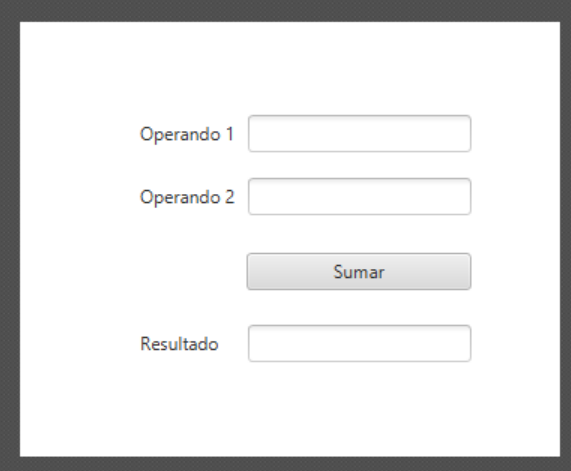

---


# 22.18 Actividad: operaciones y excepciones

Cuando el usuario escriba los números y seleccione una operación, la aplicación debe mostrar el resultado.

Controla los errores de conversión y evita la división entre cero.

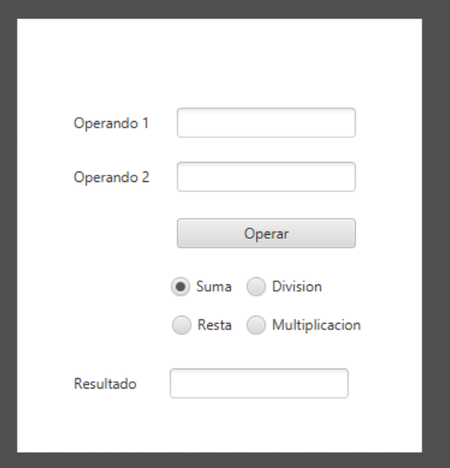

---


# Solución MVC · Calculadora ampliada

Esta versión añade las cuatro operaciones y controla datos no numéricos y la división entre cero.

---

#  Solución Calculadora ampliada · Modelo

### `CalculadoraAmpliadaModel.java`

```java
public class CalculadoraAmpliadaModel {
    public double calcular(double a, double b, String operacion) {
        switch (operacion) {
            case "+": return a + b;
            case "-": return a - b;
            case "×": return a * b;
            case "÷":
                if (b == 0) throw new ArithmeticException();
                return a / b;
            default: throw new IllegalArgumentException();
        }
    }
}
```

---

#  Solución Calculadora ampliada · Vista

### `CalculadoraAmpliadaView.jfxml`

```xml
<?xml version="1.0" encoding="UTF-8"?>

<?import javafx.geometry.Insets?>
<?import javafx.scene.control.Button?>
<?import javafx.scene.control.Label?>
<?import javafx.scene.control.TextField?>
<?import javafx.scene.layout.HBox?>
<?import javafx.scene.layout.VBox?>

<VBox fx:controller="org.example.calculadoraampliada.CalculadoraAmpliadaController"
      spacing="10.0" xmlns="http://javafx.com/javafx/21" xmlns:fx="http://javafx.com/fxml/1">

    <children>
        <TextField fx:id="numero1" promptText="Número 1" />
        <TextField fx:id="numero2" promptText="Número 2" />

        <HBox spacing="8.0">
            <children>
                <Button fx:id="sumar" text="+" />
                <Button fx:id="restar" text="-" />
                <Button fx:id="multiplicar" text="×" />
                <Button fx:id="dividir" text="÷" />
            </children>
        </HBox>

        <Label fx:id="resultado" text="Introduce dos números" />
    </children>
</VBox>
```

---

#  Solución Calculadora ampliada · Controller

### `CalculadoraAmpliadaController.java`

```java
package org.example.calculadoraampliada;

import javafx.fxml.FXML;
import javafx.scene.control.Button;
import javafx.scene.control.Label;
import javafx.scene.control.TextField;

public class CalculadoraAmpliadaController {

    // Components injectats des del fitxer FXML
    @FXML private TextField numero1;
    @FXML private TextField numero2;
    @FXML private Label resultado;
    @FXML private Button sumar;
    @FXML private Button restar;
    @FXML private Button multiplicar;
    @FXML private Button dividir;

    // Instanciem directament el model aquí
    private final CalculadoraAmpliadaModel model = new CalculadoraAmpliadaModel();

    @FXML
    public void initialize() {
        // Assignem les accions als botons
        sumar.setOnAction(e -> calcular("+"));
        restar.setOnAction(e -> calcular("-"));
        multiplicar.setOnAction(e -> calcular("×"));
        dividir.setOnAction(e -> calcular("÷"));
    }

    private void calcular(String operacion) {
        try {
            double a = Double.parseDouble(numero1.getText().trim());
            double b = Double.parseDouble(numero2.getText().trim());
            double r = model.calcular(a, b, operacion);
            resultado.setText("Resultado: " + r);
        } catch (NumberFormatException e) {
            resultado.setText("Introduce dos números válidos");
        } catch (ArithmeticException e) {
            resultado.setText("No se puede dividir entre cero");
        }
    }
}
```

---

#  Solución Calculadora ampliada · Inicio

### `App.java`

```java
package org.example.calculadoraampliada;

import javafx.application.Application;
import javafx.fxml.FXMLLoader;
import javafx.scene.Parent;
import javafx.scene.Scene;
import javafx.stage.Stage;

import java.io.IOException;

public class App extends Application {
    @Override
    public void start(Stage stage) throws IOException {
        // Carreguem directament el fitxer FXML (el qual ja s'encarrega d'invocar el controlador i la vista)
        FXMLLoader fxmlLoader = new FXMLLoader(App.class.getResource("/calculadora_ampliada_view.fxml"));
        Parent root = fxmlLoader.load();

        stage.setTitle("Calculadora ampliada");
        stage.setScene(new Scene(root, 420, 280));
        stage.show();
    }

    public static void main(String[] args) {
        launch();
    }
}
```

Requiere los imports de JavaFX para `Application`, `Scene`, `Stage`, `VBox`, `HBox`, `TextField`, `Button` y `Label`.

---

# 22.19 Actividad: alta de personas

Crea un formulario con los datos básicos de una persona.

Al pulsar el botón **\*\*Agregar persona\*\***, crea un objeto \`Persona\` y añádelo a una \`TableView\`.

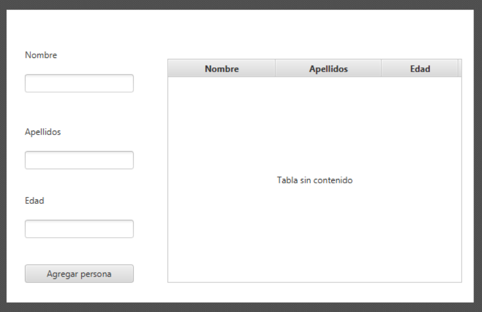

---


# Solución MVC · Alta de personas

La persona se crea como objeto y se añade a una `ObservableList` conectada con la `TableView`.

```text
Persona → datos
PersonasModel → colección observable
PersonasView → formulario y tabla
PersonasController → validación y alta
App → inicio de JavaFX
```

---

# Alta de personas · Modelo

### `Persona.java`

```java
public class Persona {
    private final String nombre;
    private final String apellidos;
    private final String email;
    private final String telefono;

    public Persona(String nombre, String apellidos,
                   String email, String telefono) {
        this.nombre = nombre;
        this.apellidos = apellidos;
        this.email = email;
        this.telefono = telefono;
    }

    public String getNombre() { return nombre; }
    public String getApellidos() { return apellidos; }
    public String getEmail() { return email; }
    public String getTelefono() { return telefono; }
}
```

---

# Alta de personas · Colección

### `PersonasModel.java`

```java
import javafx.collections.FXCollections;
import javafx.collections.ObservableList;

public class PersonasModel {
    private final ObservableList<Persona> personas =
        FXCollections.observableArrayList();

    public ObservableList<Persona> getPersonas() {
        return personas;
    }

    public void agregar(Persona persona) {
        personas.add(persona);
    }
}
```

---

# Alta de personas · Vista

### `personas_view.jfxml`

```xml
<?xml version="1.0" encoding="UTF-8"?>

<?import javafx.geometry.Insets?>
<?import javafx.scene.control.Button?>
<?import javafx.scene.control.Label?>
<?import javafx.scene.control.TableColumn?>
<?import javafx.scene.control.TableView?>
<?import javafx.scene.control.TextField?>
<?import javafx.scene.control.TitledPane?>
<?import javafx.scene.layout.ColumnConstraints?>
<?import javafx.scene.layout.GridPane?>
<?import javafx.scene.layout.HBox?>
<?import javafx.scene.layout.RowConstraints?>
<?import javafx.scene.layout.VBox?>
<?import javafx.scene.text.Font?>

<VBox spacing="15.0" xmlns="http://javafx.com/javafx/21" xmlns:fx="http://javafx.com/fxml/1" fx:controller="org.example.altapersonas.PersonasController">
    <padding>
        <Insets bottom="20.0" left="20.0" right="20.0" top="20.0" />
    </padding>

    <children>
        <!-- Capçalera principal de l'aplicació -->
        <VBox spacing="4.0" style="-fx-background-color: #f8fafc; -fx-padding: 15; -fx-background-radius: 8; -fx-border-color: #e2e8f0; -fx-border-radius: 8;">
            <children>
                <Label text="👤 Gestió d'Alta de Persones" textFill="#0f172a">
                    <font>
                        <Font name="System Bold" size="20.0" />
                    </font>
                </Label>
                <Label text="Introdueix les dades del nou registre per afegir-lo a la taula" textFill="#64748b">
                    <font>
                        <Font size="13.0" />
                    </font>
                </Label>
            </children>
        </VBox>

        <!-- Formulari d'entrada estructurat -->
        <TitledPane animated="false" text="📋 Dades Personals" collapsible="false">
            <content>
                <VBox spacing="12.0">
                    <padding>
                        <Insets bottom="15.0" left="15.0" right="15.0" top="15.0" />
                    </padding>
                    <children>
                        <GridPane hgap="12.0" vgap="10.0">
                            <columnConstraints>
                                <ColumnConstraints hgrow="NEVER" minWidth="80.0" />
                                <ColumnConstraints hgrow="ALWAYS" />
                                <ColumnConstraints hgrow="NEVER" minWidth="80.0" />
                                <ColumnConstraints hgrow="ALWAYS" />
                            </columnConstraints>
                            <rowConstraints>
                                <RowConstraints minHeight="30.0" vgrow="SOMETIMES" />
                                <RowConstraints minHeight="30.0" vgrow="SOMETIMES" />
                            </rowConstraints>
                            <children>
                                <Label text="Nom *:" textFill="#334155" GridPane.columnIndex="0" GridPane.rowIndex="0">
                                    <font><Font name="System Bold" size="12.0" /></font>
                                </Label>
                                <TextField fx:id="nombre" promptText="Ex. Joan" GridPane.columnIndex="1" GridPane.rowIndex="0" />

                                <Label text="Cognoms:" textFill="#334155" GridPane.columnIndex="2" GridPane.rowIndex="0">
                                    <font><Font name="System Bold" size="12.0" /></font>
                                </Label>
                                <TextField fx:id="apellidos" promptText="Ex. García Pérez" GridPane.columnIndex="3" GridPane.rowIndex="0" />

                                <Label text="Email *:" textFill="#334155" GridPane.columnIndex="0" GridPane.rowIndex="1">
                                    <font><Font name="System Bold" size="12.0" /></font>
                                </Label>
                                <TextField fx:id="email" promptText="joan@example.com" GridPane.columnIndex="1" GridPane.rowIndex="1" />

                                <Label text="Telèfon:" textFill="#334155" GridPane.columnIndex="2" GridPane.rowIndex="1">
                                    <font><Font name="System Bold" size="12.0" /></font>
                                </Label>
                                <TextField fx:id="telefono" promptText="600 000 000" GridPane.columnIndex="3" GridPane.rowIndex="1" />
                            </children>
                        </GridPane>

                        <HBox alignment="CENTER_LEFT" spacing="15.0">
                            <children>
                                <Button fx:id="agregar" defaultButton="true" style="-fx-cursor: hand;" text="➕ Afegir Persona" />
                                <Label fx:id="mensaje" textFill="#0369a1">
                                    <font>
                                        <Font name="System Italic" size="13.0" />
                                    </font>
                                </Label>
                            </children>
                            <VBox.margin>
                                <Insets top="5.0" />
                            </VBox.margin>
                        </HBox>
                    </children>
                </VBox>
            </content>
        </TitledPane>

        <!-- Secció de la taula de dades -->
        <VBox spacing="8.0" VBox.vgrow="ALWAYS">
            <children>
                <Label text="📄 Registres Guardats" textFill="#334155">
                    <font>
                        <Font name="System Bold" size="14.0" />
                    </font>
                </Label>
                <TableView fx:id="tabla" VBox.vgrow="ALWAYS">
                    <columns>
                        <TableColumn fx:id="colNombre" prefWidth="150.0" text="Nom" />
                        <TableColumn fx:id="colApellidos" prefWidth="200.0" text="Cognoms" />
                        <TableColumn fx:id="colEmail" prefWidth="220.0" text="Email" />
                        <TableColumn fx:id="colTelefono" prefWidth="130.0" text="Telèfon" />
                    </columns>
                    <columnResizePolicy>
                        <TableView fx:constant="CONSTRAINED_RESIZE_POLICY" />
                    </columnResizePolicy>
                </TableView>
            </children>
        </VBox>
    </children>
</VBox>
```


---

# Alta de personas · Controller

### `PersonasController.java`

```java
package org.example.altapersonas;

import javafx.fxml.FXML;
import javafx.scene.control.Button;
import javafx.scene.control.Label;
import javafx.scene.control.TableColumn;
import javafx.scene.control.TableView;
import javafx.scene.control.TextField;
import javafx.scene.control.cell.PropertyValueFactory;

public class PersonasController {

    // Instanciem el model directament (o el configurem)
    private final PersonasModel model = new PersonasModel();

    // Components injectats des del fitxer FXML
    @FXML private TextField nombre;
    @FXML private TextField apellidos;
    @FXML private TextField email;
    @FXML private TextField telefono;
    @FXML private Button agregar;
    @FXML private Label mensaje;

    @FXML private TableView<Persona> tabla;
    @FXML private TableColumn<Persona, String> colNombre;
    @FXML private TableColumn<Persona, String> colApellidos;
    @FXML private TableColumn<Persona, String> colEmail;
    @FXML private TableColumn<Persona, String> colTelefono;

    @FXML
    public void initialize() {
        // 1. Configurem les columnes de la taula
        colNombre.setCellValueFactory(new PropertyValueFactory<>("nombre"));
        colApellidos.setCellValueFactory(new PropertyValueFactory<>("apellidos"));
        colEmail.setCellValueFactory(new PropertyValueFactory<>("email"));
        colTelefono.setCellValueFactory(new PropertyValueFactory<>("telefono"));

        // 2. Assignem les dades del model a la taula
        tabla.setItems(model.getPersonas());

        // 3. Configurem l'acció del botó
        agregar.setOnAction(e -> agregarPersona());
    }

    private void agregarPersona() {
        String nom = nombre.getText().trim();
        String corr = email.getText().trim();

        if (nom.isEmpty() || corr.isEmpty()) {
            mensaje.setText("Nombre y email son obligatorios");
            return;
        }

        Persona persona = new Persona(
                nom,
                apellidos.getText().trim(),
                corr,
                telefono.getText().trim()
        );

        model.agregar(persona);

        // Netegem els camps
        nombre.clear();
        apellidos.clear();
        email.clear();
        telefono.clear();

        mensaje.setText("Persona agregada correctamente");
    }
}
```

---

# Alta de personas · Inicio

### `App.java`

```java
package org.example.altapersonas;

import javafx.application.Application;
import javafx.fxml.FXMLLoader;
import javafx.scene.Parent;
import javafx.scene.Scene;
import javafx.stage.Stage;

import java.io.IOException;

public class App extends Application {
    @Override
    public void start(Stage stage) throws IOException {
        // Carreguem el fitxer FXML des de la carpeta resources
        FXMLLoader fxmlLoader = new FXMLLoader(App.class.getResource("personas_view.fxml"));
        Parent root = fxmlLoader.load();

        stage.setTitle("Alta de personas");
        stage.setScene(new Scene(root, 760, 480));
        stage.show();
    }

    public static void main(String[] args) {
        launch();
    }
}
```

Pon las clases en el mismo paquete; `PersonasView` necesita los imports JavaFX incluidos.

---

# 22.20 Actividad: modificar y eliminar registros

Completa la actividad anterior:

- Al seleccionar un registro, muestra sus datos en los campos.

- Al pulsar **\*\*Modificar\*\***, actualiza el objeto seleccionado.

- Al pulsar **\*\*Eliminar\*\***, elimina el registro de la tabla.

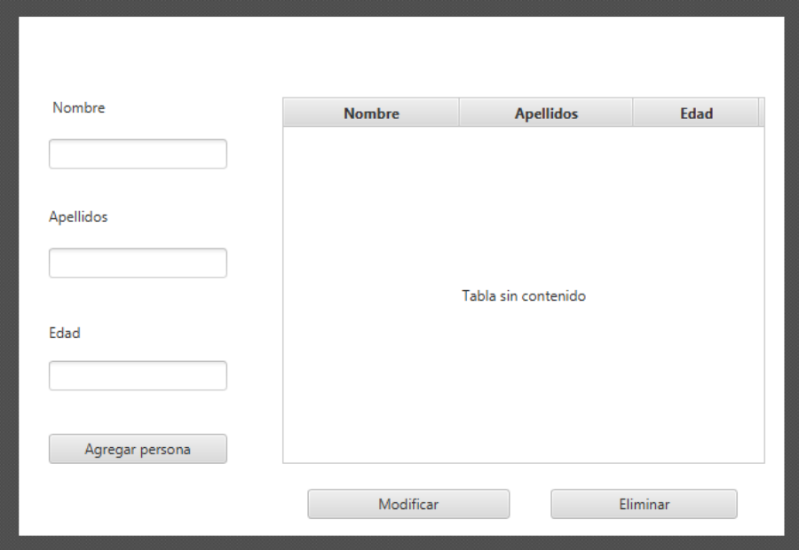

---

# Solución MVC · Modificar y eliminar personas

Al seleccionar una fila, el Controller carga sus datos en el formulario. **Modificar** actualiza el objeto y **Eliminar** pide confirmación.

---

# Personas · Modelo de edición

Esta solución va separada del código de alta. Reutiliza `Persona` sin modificarla y reemplaza en la lista el registro editado.

### `EdicionPersonasModel.java`

```java
import javafx.collections.ObservableList;

public class EdicionPersonasModel {
    private final ObservableList<Persona> personas;

    public EdicionPersonasModel(ObservableList<Persona> personas) {
        this.personas = personas;
    }

    public ObservableList<Persona> getPersonas() {
        return personas;
    }

    public void actualizar(Persona anterior, Persona actualizada) {
        int indice = personas.indexOf(anterior);
        if (indice >= 0) personas.set(indice, actualizada);
    }

    public void eliminar(Persona persona) {
        personas.remove(persona);
    }
}
```

---

# Personas · Vista de edición

### `EdicionPersonasView.java`

```java
import javafx.scene.control.*;
import javafx.scene.control.cell.PropertyValueFactory;
import javafx.scene.layout.*;

public class EdicionPersonasView extends VBox {
    final TextField nombre = new TextField();
    final TextField apellidos = new TextField();
    final TextField email = new TextField();
    final TextField telefono = new TextField();
    final Button modificar = new Button("Modificar");
    final Button eliminar = new Button("Eliminar");
    final Label mensaje = new Label();
    final TableView<Persona> tabla = new TableView<>();

    public EdicionPersonasView() {
        setSpacing(10);
        tabla.getColumns().addAll(
            columna("Nombre", "nombre"),
            columna("Apellidos", "apellidos"),
            columna("Email", "email"),
            columna("Teléfono", "telefono")
        );
        tabla.setColumnResizePolicy(
            TableView.CONSTRAINED_RESIZE_POLICY);
        getChildren().addAll(
            new HBox(8, nombre, apellidos),
            new HBox(8, email, telefono),
            new HBox(8, modificar, eliminar),
            mensaje, tabla
        );
    }

    private TableColumn<Persona, String> columna(
            String titulo, String propiedad) {
        TableColumn<Persona, String> columna =
            new TableColumn<>(titulo);
        columna.setCellValueFactory(
            new PropertyValueFactory<>(propiedad));
        return columna;
    }
}
```

---

# Personas · Controller: selección

### `EdicionPersonasController.java`

El Controller tiene su propio Modelo y Vista. El constructor conecta la tabla, la selección y los botones.

```java
import javafx.scene.control.Alert;
import javafx.scene.control.ButtonType;
import java.util.Optional;

public class EdicionPersonasController {
    private final EdicionPersonasModel model;
    private final EdicionPersonasView view;

    public EdicionPersonasController(EdicionPersonasModel model,
                                     EdicionPersonasView view) {
        this.model = model;
        this.view = view;
        view.tabla.setItems(model.getPersonas());
        view.tabla.getSelectionModel()
            .selectedItemProperty()
            .addListener((obs, anterior, seleccionada) -> {
                if (seleccionada != null) {
                    view.nombre.setText(seleccionada.getNombre());
                    view.apellidos.setText(seleccionada.getApellidos());
                    view.email.setText(seleccionada.getEmail());
                    view.telefono.setText(seleccionada.getTelefono());
                }
            });
        view.modificar.setOnAction(e -> modificarPersona());
        view.eliminar.setOnAction(e -> eliminarPersona());
    }

    // Los métodos modificarPersona() y eliminarPersona()
    // aparecen en las diapositivas siguientes.
}
```

---

# Personas · Controller: actualizar

El método valida los campos y sustituye el objeto seleccionado.

```java
private void modificarPersona() {
    Persona seleccionada =
        view.tabla.getSelectionModel().getSelectedItem();
    if (seleccionada == null) {
        view.mensaje.setText("Selecciona una persona");
        return;
    }

    String nombre = view.nombre.getText().trim();
    String email = view.email.getText().trim();
    if (nombre.isEmpty() || email.isEmpty()) {
        view.mensaje.setText("Nombre y email son obligatorios");
        return;
    }

    Persona actualizada = new Persona(
        nombre, view.apellidos.getText().trim(), email,
        view.telefono.getText().trim());
    model.actualizar(seleccionada, actualizada);
    view.mensaje.setText("Persona modificada correctamente");
}
```

---

# Personas · Controller: eliminar

Elimina el registro solo después de confirmar la acción.

```java
private void eliminarPersona() {
    Persona seleccionada =
        view.tabla.getSelectionModel().getSelectedItem();
    if (seleccionada == null) {
        view.mensaje.setText("Selecciona una persona");
        return;
    }

    Alert alerta = new Alert(Alert.AlertType.CONFIRMATION,
        "¿Quieres eliminar a " + seleccionada.getNombre() + "?",
        ButtonType.CANCEL, ButtonType.OK);
    alerta.setHeaderText("Confirmar eliminación");
    Optional<ButtonType> respuesta = alerta.showAndWait();

    if (respuesta.isPresent() && respuesta.get() == ButtonType.OK) {
        model.eliminar(seleccionada);
        view.tabla.getSelectionModel().clearSelection();
        view.mensaje.setText("Persona eliminada");
    }
}
```

---

# Personas · Inicio de la edición

### `AppEdicionPersonas.java`

Este ejemplo carga datos iniciales para poder probar la selección, edición y eliminación. En la aplicación anterior se compartiría la lista ya creada.

```java
import javafx.application.Application;
import javafx.scene.Scene;
import javafx.stage.Stage;

public class AppEdicionPersonas extends Application {
    @Override
    public void start(Stage stage) {
        PersonasModel altaModel = new PersonasModel();
        altaModel.agregar(new Persona(
            "Ana", "García", "ana@email.com", "600123123"));

        EdicionPersonasModel model =
            new EdicionPersonasModel(altaModel.getPersonas());
        EdicionPersonasView view = new EdicionPersonasView();
        new EdicionPersonasController(model, view);

        stage.setTitle("Modificar y eliminar personas");
        stage.setScene(new Scene(view, 760, 480));
        stage.show();
    }
}
```

---
# 23. Resumen de la unidad
---


# 23.1 Resumen de la unidad

## Las piezas que debemos dominar

### JavaFX

Framework de interfaz.

### Scene Builder

Diseño visual.

### FXML

Estructura de la vista.

### Java

Comportamiento y eventos.

### CSS :
Apariencia.

---


# 23.2 El flujo completo


---


# 23.3 La idea fundamental

> **\*\*Una interfaz no es solo una pantalla bonita.\*\***

Debe existir una relación coherente entre:

**\*\*diseño + estructura + comportamiento + interacción + apariencia\*\***

Nuestro trabajo como desarrolladores será conseguir que todas estas piezas funcionen juntas.

---


# 23.4 Preguntas de repaso

1\. ¿Qué diferencia hay entre \`Stage\` y \`Scene\`?

2\. ¿Qué es un \`Node\`?

3\. ¿Para qué sirve un layout?

4\. ¿Qué problema resuelve Scene Builder?

5\. ¿Qué información contiene un FXML?

6\. ¿Para qué sirve \`fx\:id\`?

7\. ¿Dónde programamos los eventos?

8\. ¿Qué papel tiene CSS?

---


# 23.5 ¿Qué viene después?

En las próximas sesiones pasaremos de:

**\*\*diseñar una pantalla\*\***

→ a

**\*\*conectar esa pantalla con Java\*\***

→ a

**\*\*crear aplicaciones con varias pantallas y comportamiento real\*\***.

### Próximo paso

**\*\*FXML + Controller + eventos\*\***

---
# 24. Cierre y preparación de la siguiente unidad
---


# 24.1 Resultado esperado de la UD1

Al finalizar la unidad, el alumnado debe ser capaz de:

- crear un proyecto JavaFX;
- identificar `Stage`, `Scene` y `Node`;
- diseñar interfaces con Scene Builder;
- escoger y combinar layouts;
- utilizar controles JavaFX;
- configurar propiedades;
- comprender y editar FXML;
- utilizar `fx:id`;
- conectar FXML con un Controller;
- programar eventos;
- utilizar `initialize()`;
- aplicar CSS externo;
- validar entradas;
- mostrar `Alert` y diálogos;
- navegar entre vistas;
- utilizar `TableView` y `ObservableList`;
- organizar un proyecto por responsabilidades;
- diagnosticar errores habituales;
- construir una aplicación integradora.

---


# 24.2 Evidencias de aprendizaje

## Evidencias prácticas

El alumnado debe poder demostrar:

| Evidencia | Se demuestra mediante |
|---|---|
| Diseño visual | Scene Builder |
| Organización | Layouts |
| Componentes | Controles JavaFX |
| Configuración | Properties |
| Estructura | FXML |
| Estilo | CSS |
| Identificación | `fx:id` |
| Interacción | Eventos |
| Lógica | Controller |
| Integración | FXML ↔ Controller |
| Robustez | Validación |
| Comunicación | Alert / diálogos |
| Flujo | Navegación |
| Aplicación global | Proyecto integrador |

---


# 24.3 Resumen final · las 14 piezas

```text
┌─────────────────────────────────────┐
│ 1  JavaFX + Scene Builder           │
│ 2  Layouts                          │
│ 3  Controles                        │
│ 4  Propiedades                      │
│ 5  FXML                             │
│ 6  CSS                              │
│ 7  fx:id                            │
│ 8  Eventos                          │
│ 9  Controller                       │
│ 10 FXML ↔ Controller                │
│ 11 Validación                       │
│ 12 Alert / diálogos                 │
│ 13 Navegación                       │
│ 14 Proyecto integrador              │
└─────────────────────────────────────┘
```

### La regla que debemos recordar

> **Scene Builder diseña · FXML estructura · CSS presenta · Controller coordina · Java ejecuta la lógica.**

---


# 24.4 Cierre de la UD1

## De una pantalla a una aplicación

Hemos pasado de:

```text
Button
```

a:

```text
Button
 ↓
Evento
 ↓
Controller
 ↓
Validación
 ↓
Modelo
 ↓
TableView
 ↓
Alert
 ↓
Navegación
```

Ese es el salto importante de la unidad:

> **No aprender controles de memoria, sino aprender a construir interfaces que funcionan.**

---


# 24.5 Preparación para la siguiente unidad

Antes de continuar, debes poder explicar sin consultar apuntes:

```text
¿Qué es JavaFX?
¿Qué es Scene Builder?
¿Qué es un layout?
¿Qué es FXML?
¿Qué es fx:id?
¿Qué es un Controller?
¿Cómo se conecta FXML con Java?
¿Qué es un evento?
¿Cómo valido datos?
¿Cómo muestro un Alert?
¿Cómo cambio de pantalla?
¿Cómo aplico CSS?
```

Si puedes responder y además construir una pequeña aplicación que utilice todas estas piezas, tienes la base necesaria para continuar con el desarrollo de interfaces JavaFX.

